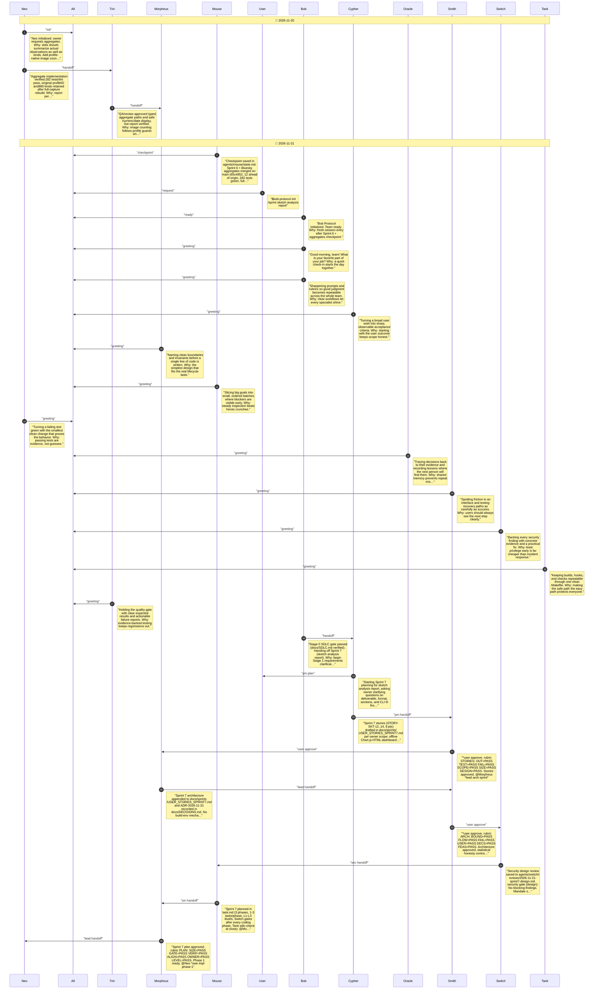
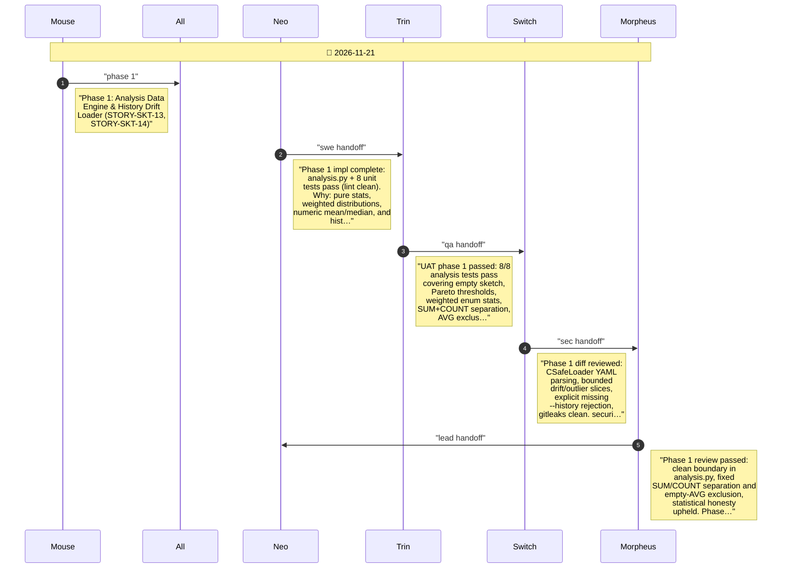
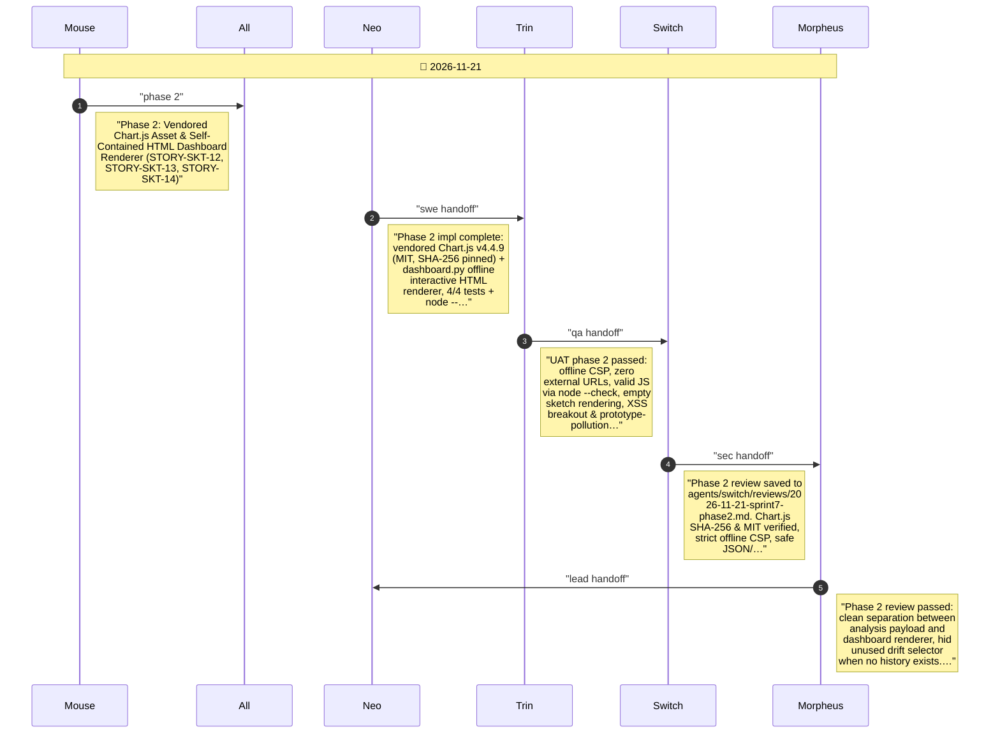
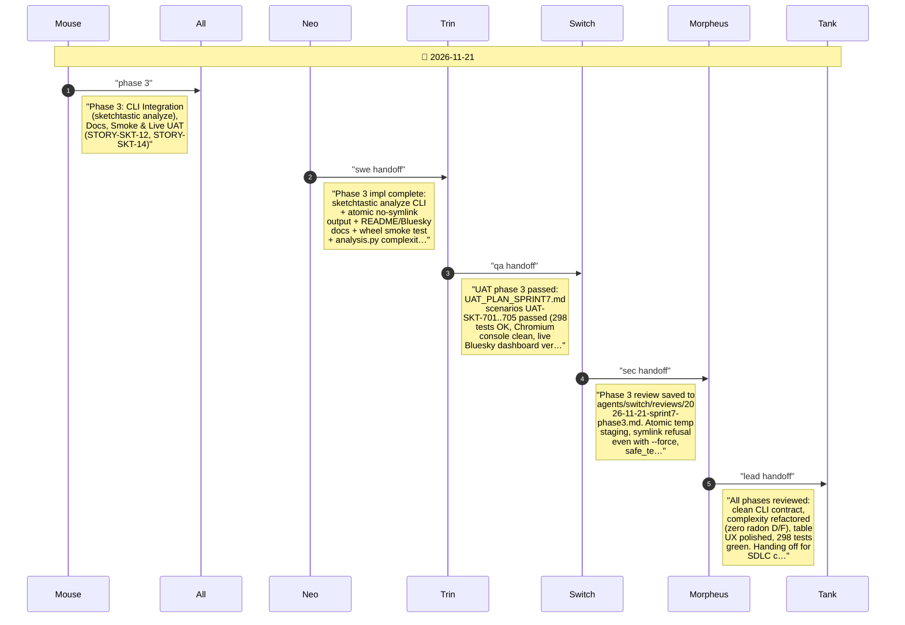

# CHAT.md — Conversation Flow

Auto-generated from `agents/CHAT.md` by `bobp chat-diagram`. Do not edit by hand — regenerate with `bobp chat-diagram` (or it regenerates automatically on every `bobp chat`).

## Phase 1 starts

Phase 1: Analysis Data Engine &amp; History Drift Loader (STORY-SKT-13, STORY-SKT-14)

## Phase 1 close-out

- **Neo**: Phase 1 impl complete: analysis.py + 8 unit tests pass (lint clean). Why: pure stats, weighted distributions, numeric mean/median, and hist…
- **Trin**: UAT phase 1 passed: 8/8 analysis tests pass covering empty sketch, Pareto thresholds, weighted enum stats, SUM+COUNT separation, AVG exclus…
- **Morpheus**: Phase 1 review passed: clean boundary in analysis.py, fixed SUM/COUNT separation and empty-AVG exclusion, statistical honesty upheld. Phase…

## Phase 2 starts

Phase 2: Vendored Chart.js Asset &amp; Self-Contained HTML Dashboard Renderer (STORY-SKT-12, STORY-SKT-13, STORY-SKT-14)

## Phase 2 close-out

- **Neo**: Phase 2 impl complete: vendored Chart.js v4.4.9 (MIT, SHA-256 pinned) + dashboard.py offline interactive HTML renderer, 4/4 tests + node --…
- **Trin**: UAT phase 2 passed: offline CSP, zero external URLs, valid JS via node --check, empty sketch rendering, XSS breakout &amp; prototype-pollution…
- **Morpheus**: Phase 2 review passed: clean separation between analysis payload and dashboard renderer, hid unused drift selector when no history exists.…

## Phase 3 starts

Phase 3: CLI Integration (sketchtastic analyze), Docs, Smoke &amp; Live UAT (STORY-SKT-12, STORY-SKT-14)

## Phase 3 so far

- **Neo**: Phase 3 impl complete: sketchtastic analyze CLI + atomic no-symlink output + README/Bluesky docs + wheel smoke test + analysis.py complexit…
- **Trin**: UAT phase 3 passed: UAT\_PLAN\_SPRINT7.md scenarios UAT-SKT-701..705 passed (298 tests OK, Chromium console clean, live Bluesky dashboard ver…
