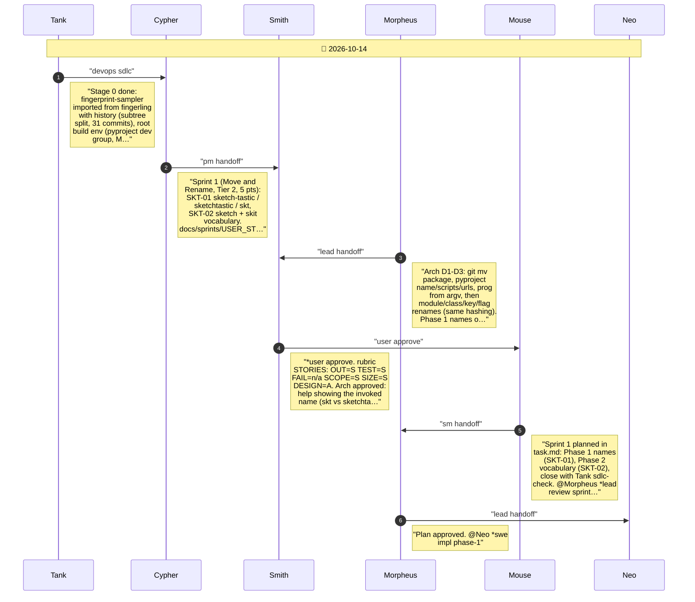
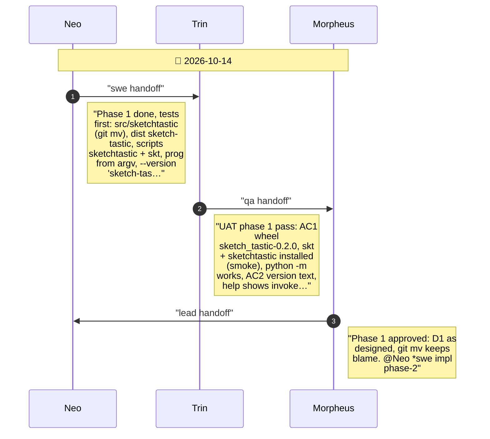
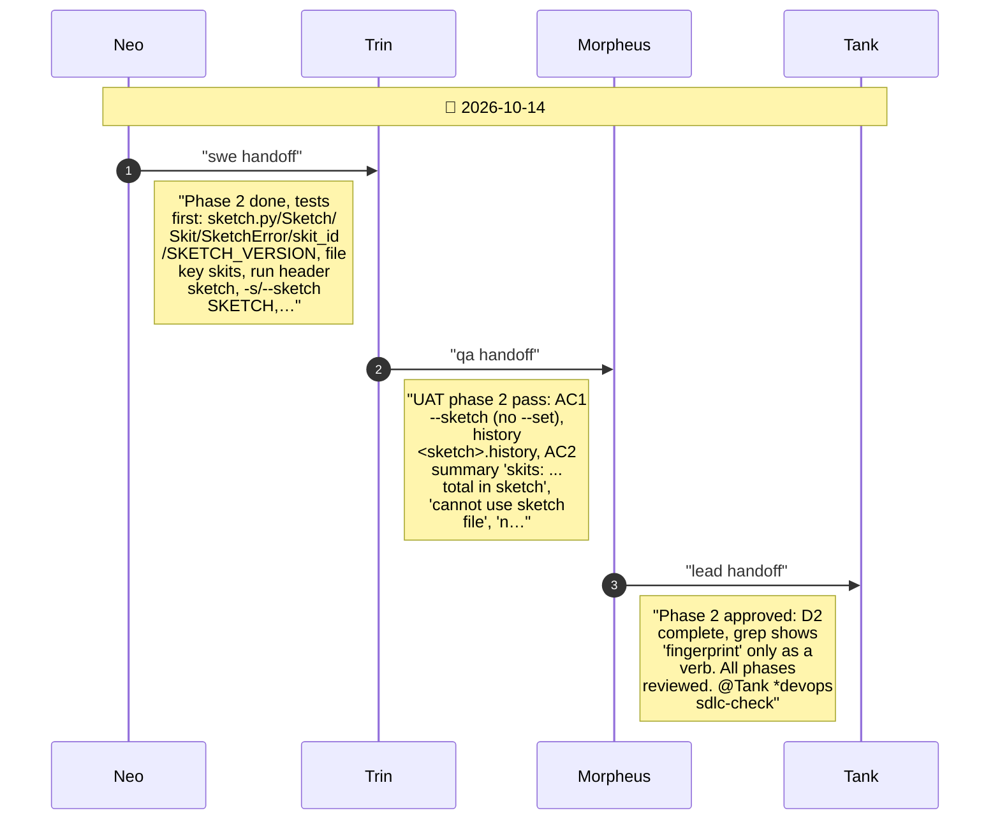
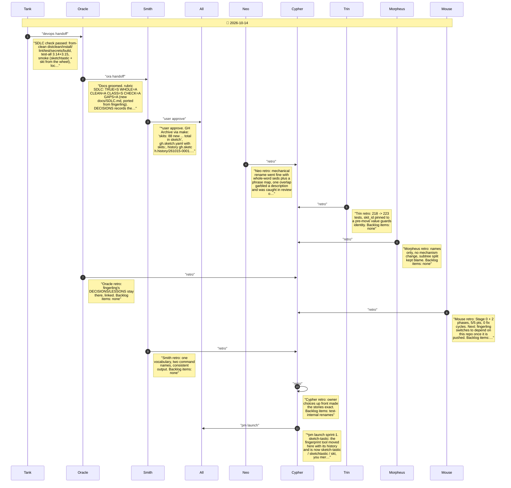

# CHAT_SPRINT_1 — Sprint Archive

## Summary

Sprint 1, Move and Rename (Tier 2, 5 pts, 0 fix cycles). Stage 0 (Tank): fingerprint-sampler imported from fingerling with history via subtree split; root build env, Makefile, uv.lock, hooks, manual CI, docs/SDLC.md. SKT-01: distribution sketch-tastic, import sketchtastic, commands sketchtastic and skt. SKT-02: the set is a sketch, one fingerprint a skit (Sketch, Skit, --sketch, skits:). No release (mainline).

---

## Planning

---

## Phase 1

Phase 1: new names - sketch-tastic, sketchtastic, skt (SKT-01)

---

## Phase 2

Phase 2: sketch and skit vocabulary (SKT-02)

---

## Close

Close: Tank SDLC check, Oracle groom, Smith user test, retro, launch

