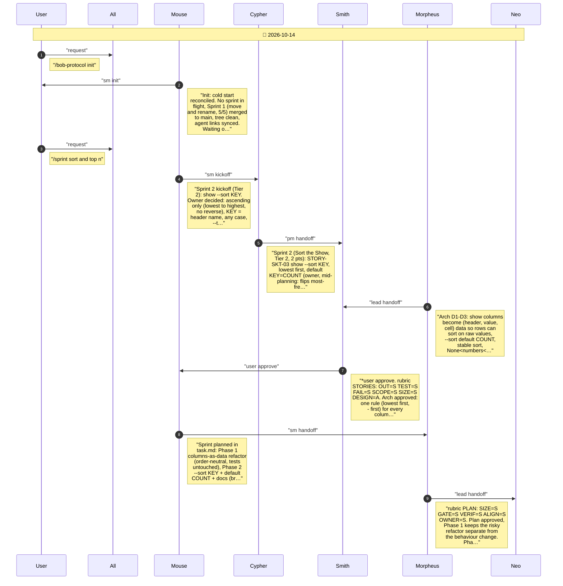
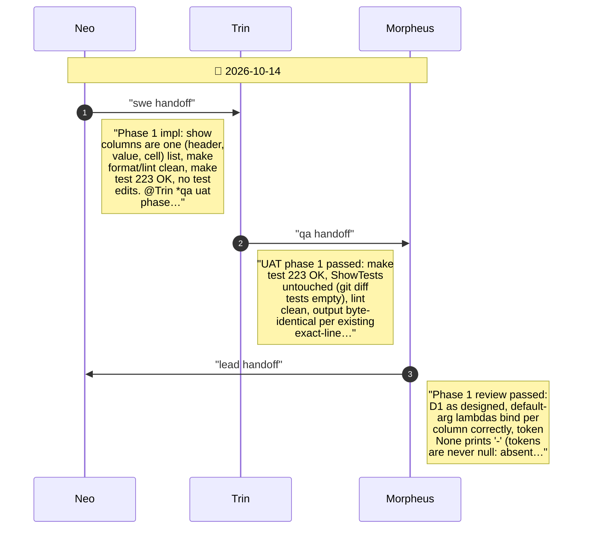
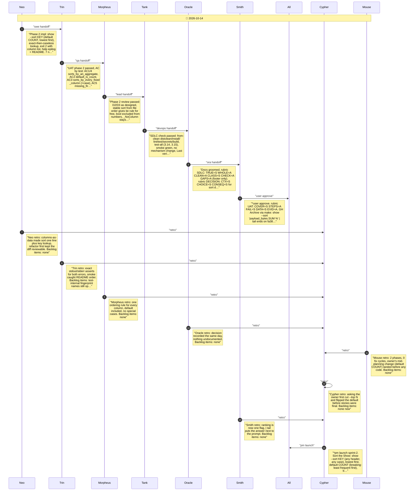

# CHAT_SPRINT_2 — Sprint Archive

## Summary

Sprint 2, Sort the Show (Tier 2, 2 pts, 0 fix cycles). Owner: sort lowest first only, KEY = header any case, default COUNT (flips most-frequent-first), --top N dropped. Phase 1 refactored show columns to (header, value, cell) data, output unchanged. Phase 2 added show --sort KEY: '-' first, numbers before text, ties in file order, unknown/ambiguous key exits 2 listing columns; help and README. GH Archive: | tail shows heaviest skit. No release (mainline).

---

## Planning

---

## Phase 1

Columns as data: refactor show to one (header, value, cell) list, table unchanged

---

## Phase 2

--sort KEY, default COUNT (lowest first), help and README

