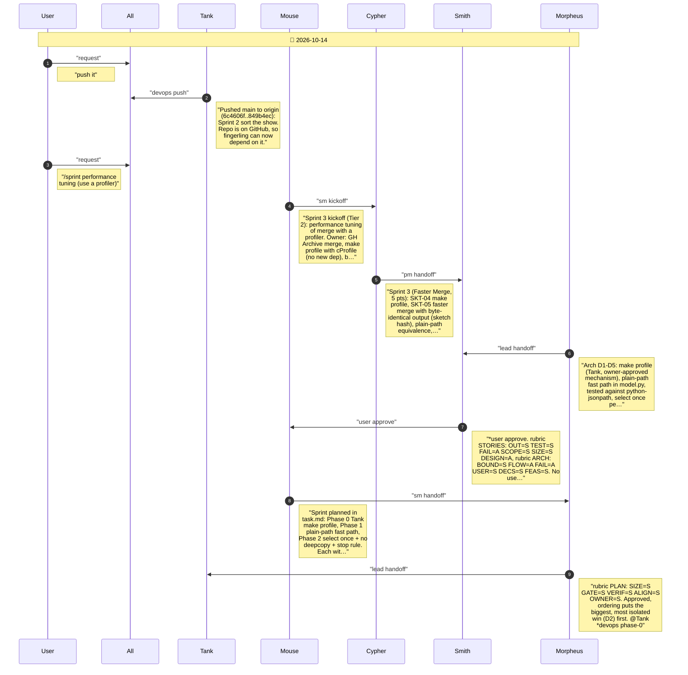
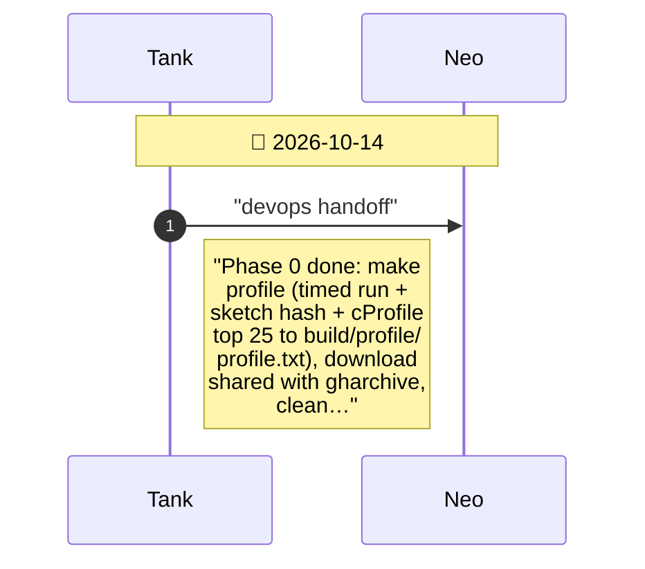
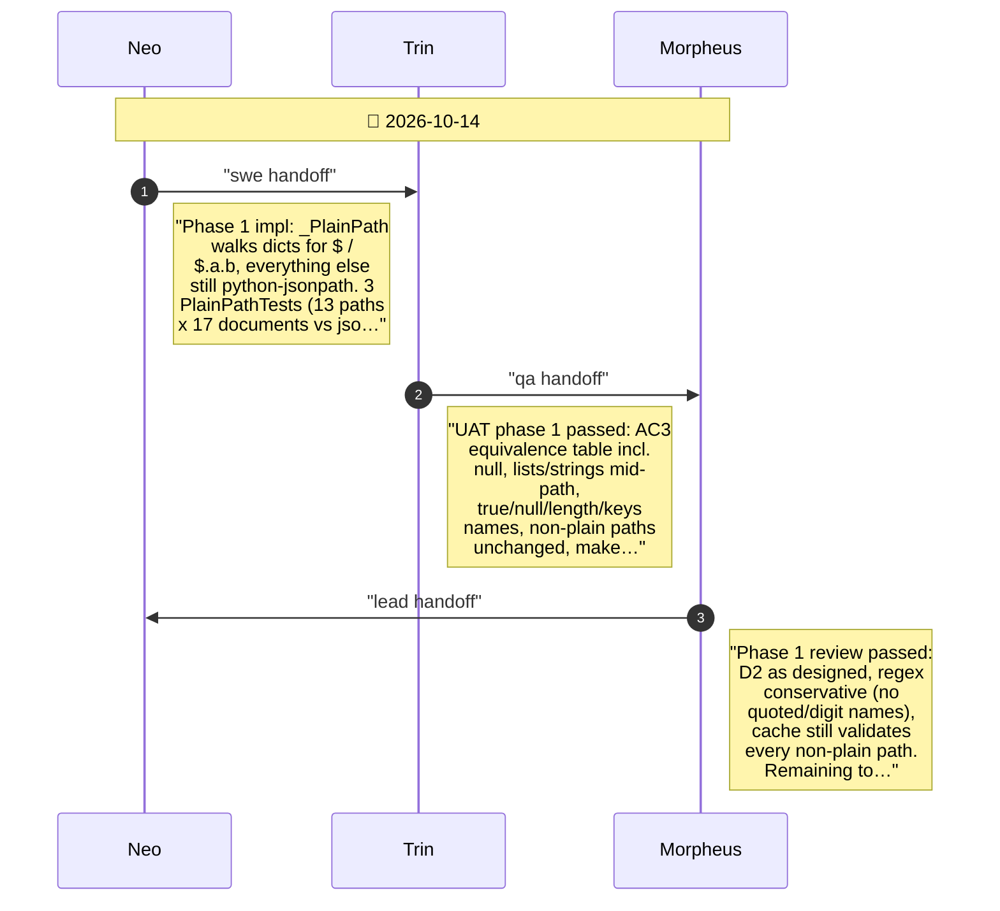
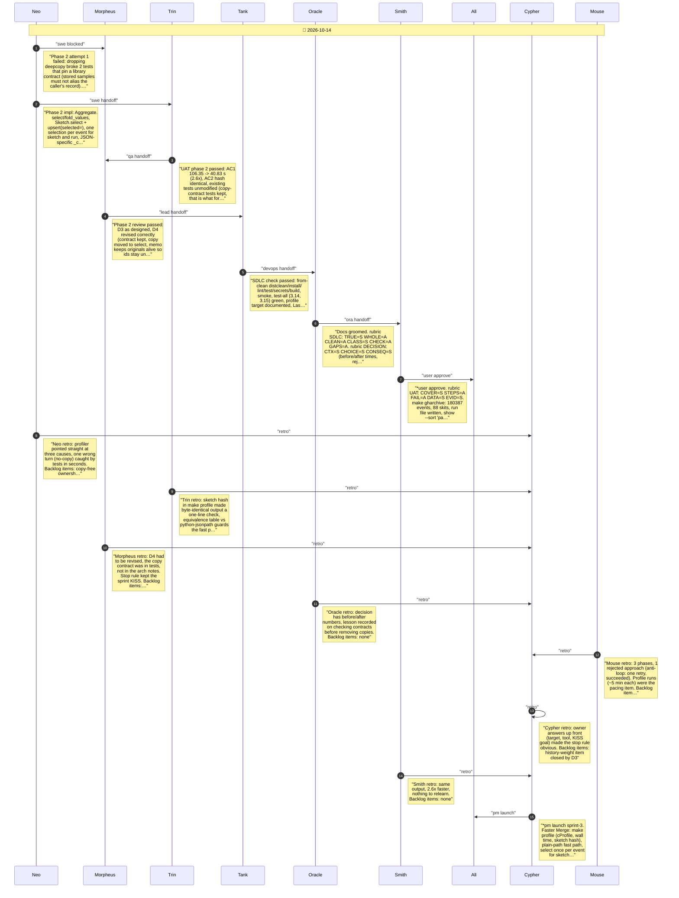

# CHAT_SPRINT_3 — Sprint Archive

## Summary

Sprint 3, Faster Merge (Tier 2, 5 pts). Owner: tune merge on the GH Archive hour with a profiler via make, stdlib cProfile, best effort KISS. Phase 0 (Tank): make profile (wall time, sketch hash, cProfile top 25); baseline 106.35 s. Phase 1: plain JSONPaths walk dicts (tested against python-jsonpath): 54.48 s. Phase 2: select once per event for sketch and run file; dropping deepcopy broke the copy contract, revised to one JSON-specific copy per event: 40.83 s. Hash unchanged throughout. Lesson on defensive copies. No release.

---

## Planning

---

## Phase 0

make profile: time, hash and cProfile the GH Archive merge

---

## Phase 1

Plain-path fast path in model.py, tested against python-jsonpath

---

## Phase 2

Select once per event, FIRST/LAST without deepcopy, alias-free dump

