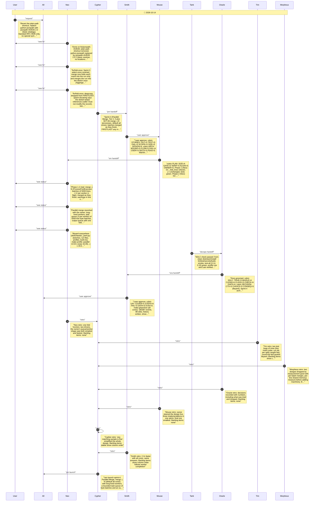

# CHAT_SPRINT_4 — Sprint Archive

## Summary

Sprint 4, Parallel Merge (Tier 2, 5 pts). Preceded by the owner's review of Sprint 3: JSONPath via jsonpath-rfc9535, fold once then merge, no FIRST/LAST copies (32.88 s). Owner design: processes, -j N default all cores, any matching FIRST/LAST sample. Pool with per-batch merges (17-19 s) and per-line shared-memory ring (25.7 s) measured and dropped; final: long-lived workers, bounded task queue of byte batches, output queue (16.46 s). libyaml everywhere: 13.54 s on 4 cores, 29.55 s -j 1. No release.

