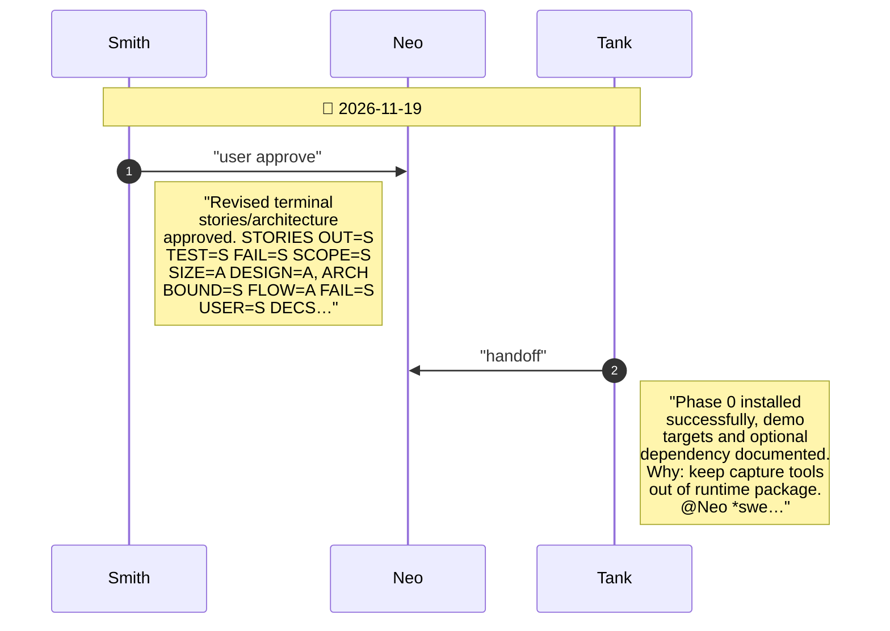
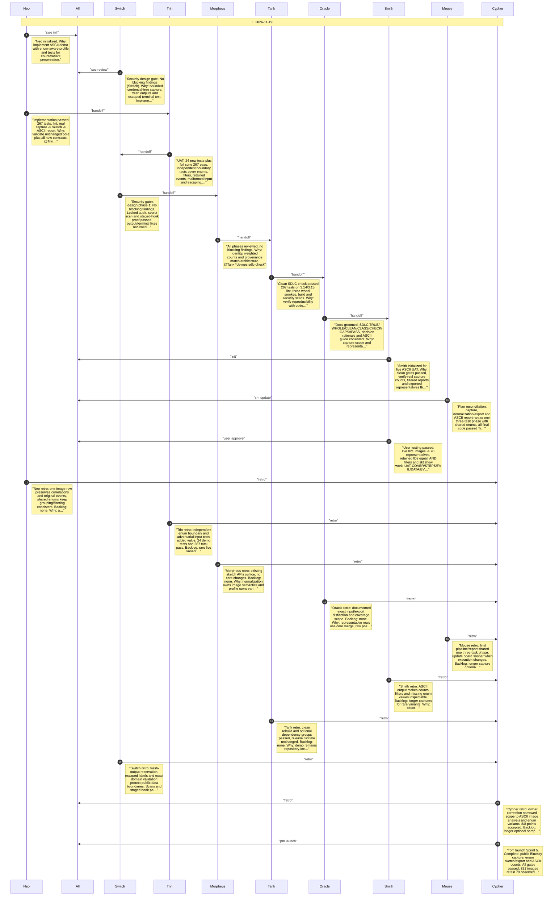

# CHAT_SPRINT_5 — Sprint Archive

## Summary

Sprint 5 delivered the repository-local Bluesky ASCII image-count demo. Bounded public capture and six enum dimensions produce representative image rows preserving the observed skit set. Live UAT: 4587 events, 821 images, 70 representatives. 267 tests pass on Python 3.14 and 3.15, with lint, wheel smoke/build, security scans and independent reviews. Owner-updated Bob Protocol skills included. No push or release.

---

## Planning

```mermaid
%%{init: {"sequence": {"messageFontSize": 14, "noteFontSize": 18, "actorFontSize": 14}}}%%
sequenceDiagram
    autonumber
    participant User
    participant All
    participant Tank
    participant Neo
    participant Mouse
    participant Morpheus
    participant Oracle
    participant Cypher
    participant Smith
    Note over User,Smith: 📅 2026-10-14
    User->>All: "request"
    Note right of User: "push sketch"
    Tank->>All: "devops push"
    Note right of Tank: "Pushed sketch-tastic<br/>main to origin (through<br/>bcabf73: post-Sprint 3<br/>fixes + Sprint 4).<br/>fingerling not touched<br/>(its pin bump to 849b4ec<br/>is s…"
    Note over User,Smith: 📅 2026-10-15
    Neo->>User: "swe fix"
    Note right of Neo: "Profile is the only<br/>source of key order:<br/>every skit starts with<br/>every aggregate in<br/>profile order at its<br/>initial state (0, [],<br/>AVG {null,0,0…"
    User->>All: "request"
    Note right of User: "Skit ids from token<br/>values in profile order<br/>(no keys), profile_id<br/>from field specs in<br/>profile order (v0: no<br/>compatibility)."
    Neo->>User: "swe fix"
    Note right of Neo: "Skit id = MD5 of JSON<br/>token values in profile<br/>order (no keys),<br/>profile_id = field specs<br/>in profile order. Golden<br/>ids, README quickstart<br/>(sm…"
    User->>All: "request"
    Note right of User: "push main"
    Tank->>All: "devops push"
    Note right of Tank: "Pushed main to origin<br/>(through 636243e:<br/>profile-order defaults,<br/>profile-ordered skit<br/>ids)."
    Mouse->>User: "handoff"
    Note right of Mouse: "Prepared for a context<br/>clear:<br/>Mouse/Neo/Morpheus state<br/>and task.md updated<br/>(pipeline, profile-order<br/>rules, measurements,<br/>owner rules, backl…"
    Note over User,Smith: 📅 2026-11-17
    User->>All: "request"
    Note right of User: "PyPI packaging with bob-<br/>protocol Init, corrected<br/>target is sketch-tastic,<br/>not fingerling."
    Tank->>All: "devops init"
    Note right of Tank: "Initialized Tank for<br/>sketch-tastic PyPI<br/>packaging. Why:<br/>packaging and trusted-<br/>publishing configuration<br/>already exist, reconcile<br/>their curre…"
    Tank->>Morpheus: "handoff"
    Note right of Tank: "Initialization complete<br/>in sketch-tastic.<br/>Existing Hatchling<br/>packaging,<br/>build/smoke/release-<br/>check targets and<br/>trusted-publishing<br/>workflow f…"
    User->>All: "request"
    Note right of User: "pypi publishing please"
    Tank->>All: "devops init"
    Note right of Tank: "Resuming PyPI publishing<br/>as Tank. Why: owner<br/>requested release,<br/>checking existing<br/>workflow, release<br/>version and external<br/>setup."
    Tank->>Tank: "handoff"
    Note right of Tank: "Release 0.2.0 build and<br/>tag-version check pass,<br/>GitHub pypi environment<br/>created. Awaiting owner<br/>pending publisher setup<br/>on PyPI. No tag pus…"
    Tank->>All: "devops resume"
    Note right of Tank: "Owner confirms PyPI<br/>publisher is pending,<br/>resuming authorized<br/>0.2.0 publication. Why:<br/>account setup<br/>prerequisite is<br/>complete."
    Tank->>Tank: "handoff"
    Note right of Tank: "Published sketch-tastic<br/>0.2.0: CI and trusted<br/>publishing succeeded<br/>(run 44212325102), PyPI<br/>wheel and sdist<br/>verified. No approval<br/>button nee…"
    Note over User,Smith: 📅 2026-11-18
    User->>All: "request"
    Note right of User: "prep for clear"
    Tank->>All: "devops resume"
    Note right of Tank: "Tank preparing cold-<br/>start handoff. Why:<br/>preserve completed PyPI<br/>release and outstanding<br/>local documentation<br/>changes before context<br/>clear."
    Tank->>Tank: "handoff"
    Note right of Tank: "Ready for context clear:<br/>0.2.0 published and CI<br/>green, Tank state has<br/>release URL, exact<br/>resume steps and<br/>uncommitted-file<br/>inventory. No sp…"
    User->>All: "request"
    Note right of User: "commit docs too please"
    Tank->>All: "devops resume"
    Note right of Tank: "Tank preparing<br/>documentation commit.<br/>Why: owner requested<br/>saving release records<br/>and clear-session<br/>handoff in git."
    Tank->>Tank: "handoff"
    Note right of Tank: "Release docs reviewed<br/>and ready to commit with<br/>saved cold-start state.<br/>Why: preserve successful<br/>0.2.0 publication, no<br/>package changes or te…"
    Note over User,Smith: 📅 2026-11-19
    User->>All: "request"
    Note right of User: "Assess HDFS for minimal<br/>regression test-data<br/>selection, informed by<br/>owner experience with<br/>electronic trading order<br/>types and parameters."
    Oracle->>All: "ora ask"
    Note right of Oracle: "Oracle initialized for<br/>HDFS suitability<br/>research. Why: determine<br/>coverage units, source-<br/>informed fields and<br/>whether recorded logs<br/>can suppo…"
    Oracle->>All: "ora resume"
    Note right of Oracle: "Owner requested<br/>rereading docs after<br/>research drift. Why:<br/>ground dataset<br/>assessment in existing p<br/>rofile/token/skit/sample<br/>behavior, not rep…"
    Oracle->>Oracle: "handoff"
    Note right of Oracle: "Docs reread: profiles<br/>collapse attribute<br/>values into token<br/>combinations, each skit<br/>already stores original-<br/>row samples plus<br/>counts/aggregat…"
    User->>All: "request"
    Note right of User: "Create Bluesky image-<br/>count visualization,<br/>sketch must capture<br/>observed meaningful<br/>variants of the<br/>visualization attributes<br/>and retain sampl…"
    Oracle->>Cypher: "handoff"
    Note right of Oracle: "Research complete:<br/>canonical image/gallery<br/>schemas found in<br/>bluesky-social/bsky.<br/>Why: shared attributes<br/>must cover actual image<br/>forms. @Cyp…"
    Cypher->>All: "pm init"
    Note right of Cypher: "Cypher initialized for<br/>Sprint 5. Why: define a<br/>reproducible image-count<br/>app with a sketch<br/>profile covering every<br/>displayed dimension."
    Cypher->>Smith: "handoff"
    Note right of Cypher: "Stories ready: SKT-08<br/>capture/sketch and<br/>SKT-09 image explorer.<br/>Why: define count<br/>semantics and shared<br/>dimensions before<br/>implementation. @S…"
    Smith->>All: "user init"
    Note right of Smith: "Smith initialized:<br/>reviewed Sprint 5<br/>stories. Why: verify<br/>capture counts, observed<br/>variants, original<br/>samples and failure<br/>behavior align wi…"
    Smith->>Morpheus: "user approve"
    Note right of Smith: "*user approve Gate 1.<br/>rubric STORIES: OUT=S<br/>TEST=S FAIL=A SCOPE=S<br/>SIZE=A DESIGN=A. Why:<br/>measurable app behavior<br/>and explicit observed-<br/>data…"
    Morpheus->>All: "lead init"
    Note right of Morpheus: "Morpheus initialized for<br/>Sprint 5 architecture.<br/>Why: use existing<br/>Sketch/Profile APIs and<br/>derive UI dimensions<br/>from the profile."
    Morpheus->>Smith: "handoff"
    Note right of Morpheus: "Architecture ready, new<br/>make targets and<br/>optional capture<br/>dependency need Tank<br/>Phase 0. Why: retain<br/>existing sketch<br/>mechanism and one dimen…"
    Smith->>All: "user init"
    Note right of Smith: "Smith resumed Gate 2.<br/>Why: review actual count<br/>semantics and error<br/>states before<br/>implementation."
    Smith->>Mouse: "user approve"
    Note right of Smith: "*user approve Gate 2.<br/>rubric ARCH: BOUND=S<br/>FLOW=A FAIL=A USER=S<br/>DECS=A FEAS=A. Why:<br/>counts, variants and<br/>capture limits are<br/>explicit. @Mous…"
    Mouse->>All: "sm init"
    Note right of Mouse: "Mouse initialized for<br/>Sprint 5 plan. Why:<br/>split build setup, data<br/>pipeline and UI into<br/>bounded phases."
    Mouse->>Morpheus: "handoff"
    Note right of Mouse: "Sprint 5 tasks recorded<br/>in task.md. Why: bounded<br/>setup, pipeline and UI<br/>phases with explicit<br/>gates. @Morpheus *lead<br/>review sprint 5 plan."
    Morpheus->>Tank: "handoff"
    Note right of Morpheus: "Plan approved. rubric<br/>PLAN: SIZE=A GATE=A<br/>VERIF=A ALIGN=S OWNER=A.<br/>Why: phases map to<br/>approved outcomes. @Tank<br/>*devops bootstrap demo<br/>targe…"
    User->>All: "request"
    Note right of User: "Owner confirms local<br/>repository, enumerated<br/>values/branch<br/>distinctions, and ASCII<br/>terminal output. No web<br/>app."
    Tank->>All: "devops init"
    Note right of Tank: "Tank initialized. Why:<br/>owner simplified UI to<br/>ASCII, add only Python<br/>demo targets and<br/>optional WebSocket<br/>capture group."
```

---

## Phase 0

Phase 0: Python-only demo targets and optional capture tools. Why: owner explicitly requests ASCII, not web.

---

## Phase 1

Phase 1: capture, normalize, sketch and retain real image variants.

## Sprint close-out

- **Cypher**: \*pm launch Sprint 5. Complete: public Bluesky capture, enum sketch/export and ASCII counts. All gates passed, 821 images retain 70 observed…
