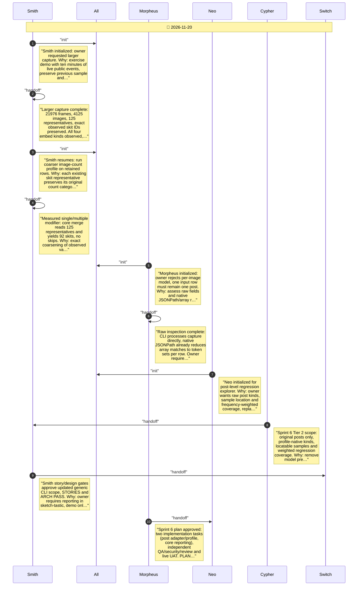
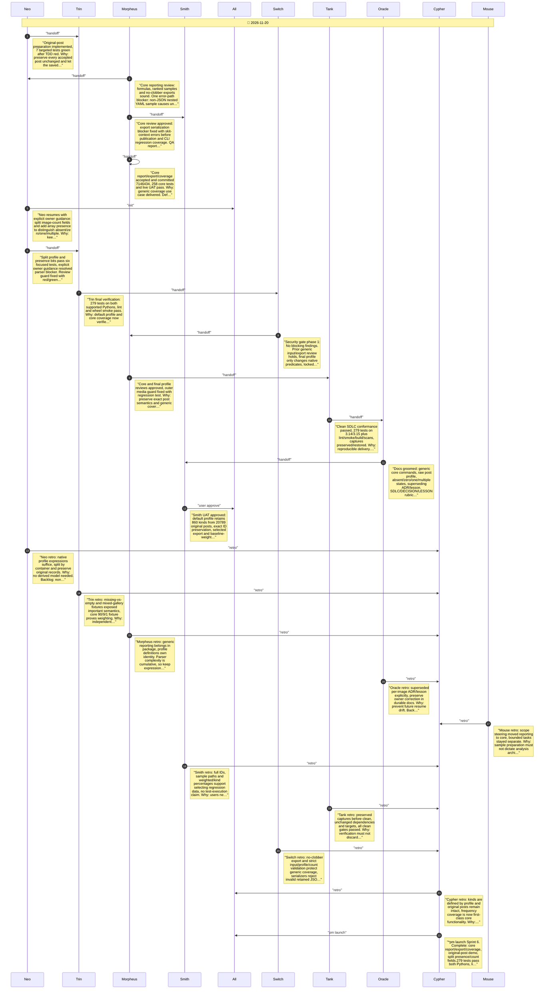

# CHAT_SPRINT_6 — Sprint Archive

## Summary

Sprint 6 delivered generic sketch-tastic report, representative export and frequency-weighted regression coverage. The Bluesky example now preserves one original post per row; native split profile fields distinguish absent arrays and zero/one/multiple image members including mixed galleries. Owner clarified core ownership and approved profile splitting after parser-complexity diagnosis. Independent review and clean gates passed:279 tests on Python3.14/3.15 plus lint, wheel smoke/build and security scans. Live default profile:20789 posts,860 kinds, exact representative ID preservation and100% full-corpus coverage. No push or release.

---

## Planning

---

## Phase 1

Original post ingestion and generic report/export/coverage; preserve observed frequency weights. Why: regression coverage is a core sketch use case.

## Sprint close-out

- **Cypher**: \*pm launch Sprint 6. Complete: core report/export/coverage, original-post demo, split presence/count fields.279 tests pass both Pythons, li…
