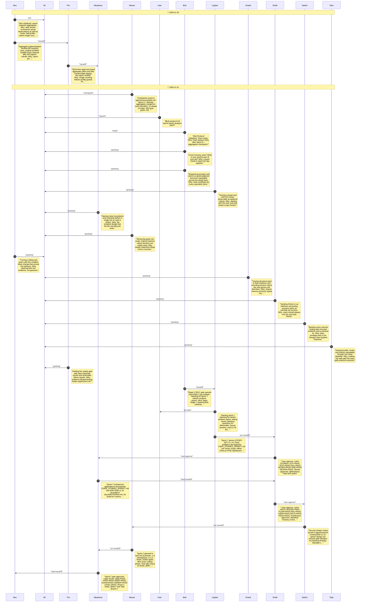
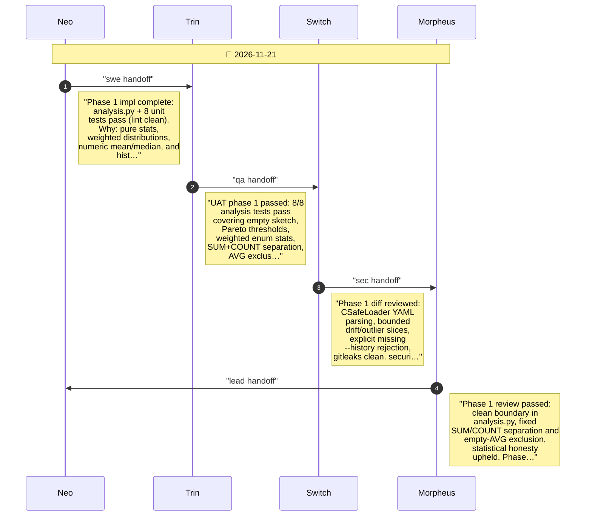
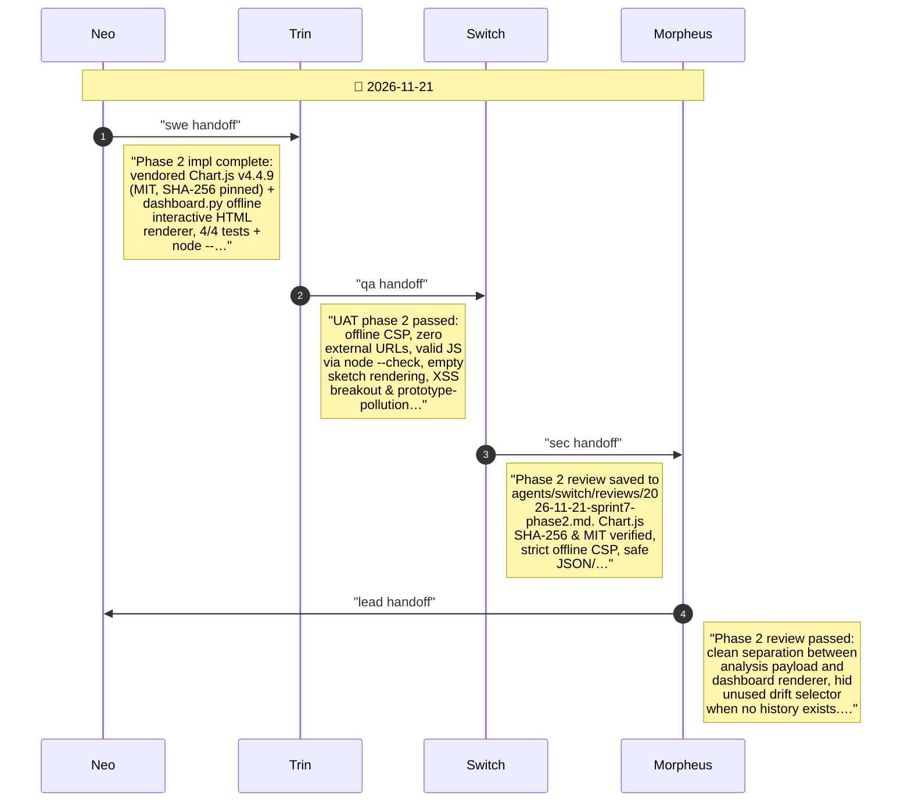
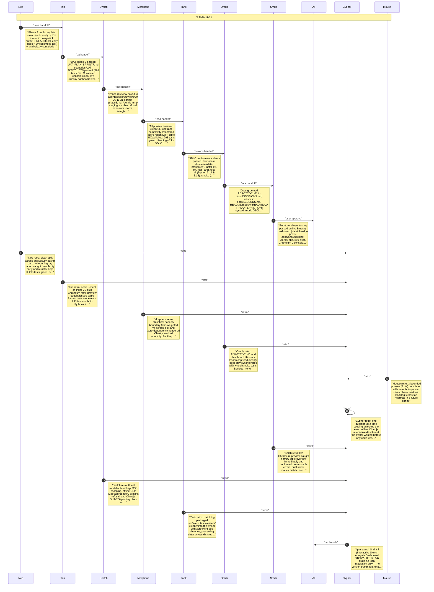

# CHAT_SPRINT_7 — Sprint Archive

## Summary

Sprint 7 delivered sketchtastic analyze SKETCH -o REPORT.html (Tier 1, 8 pts, 0 fix loops): pure statistical analysis and .history/ drift engine (analysis.py), vendored Chart.js v4.4.9 MIT with SHA-256 pin (assets/), 100% offline CSP interactive HTML dashboard (dashboard.py) with dual time/run sliders, weighted enum distributions, min/max and numeric mean/median stats, aggregate rollups, and skit/sample inspector. Verified: 298 tests on Python 3.14 & 3.15, 4 wheel smoke tests, security-scan (0 leaks/0 vulns), and live Chromium check on Bluesky (20,789 obs, 860 skits, 0 console errors). Merged locally to main; no push or release.

---

## Planning

---

## Phase 1

Phase 1: Analysis Data Engine & History Drift Loader (STORY-SKT-13, STORY-SKT-14)

---

## Phase 2

Phase 2: Vendored Chart.js Asset & Self-Contained HTML Dashboard Renderer (STORY-SKT-12, STORY-SKT-13, STORY-SKT-14)

---

## Phase 3

Phase 3: CLI Integration (sketchtastic analyze), Docs, Smoke & Live UAT (STORY-SKT-12, STORY-SKT-14)

## Sprint close-out

- **Cypher**: \*pm launch Sprint 7 (Interactive Sketch Analysis Dashboard, STORY-SKT-12..14). Mainline local integration only — no version bump, tag, or p…
