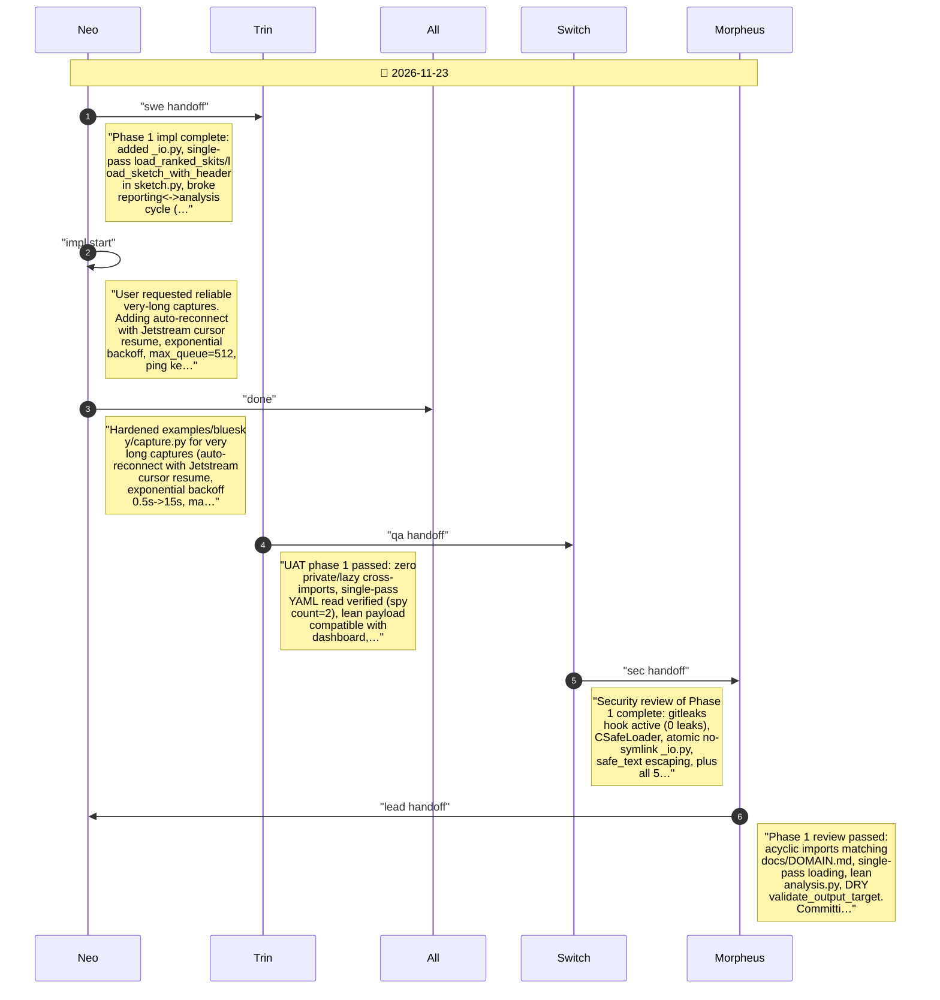
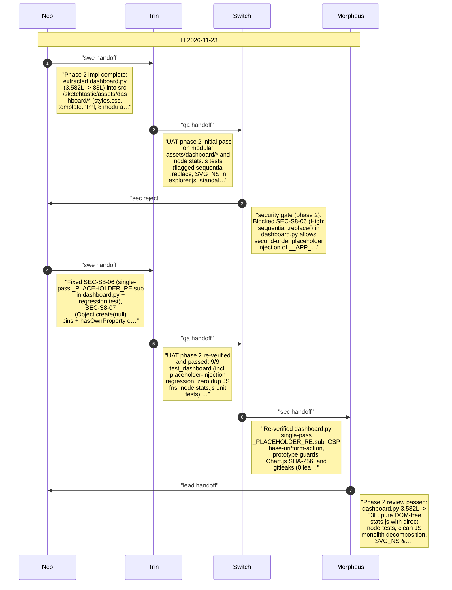
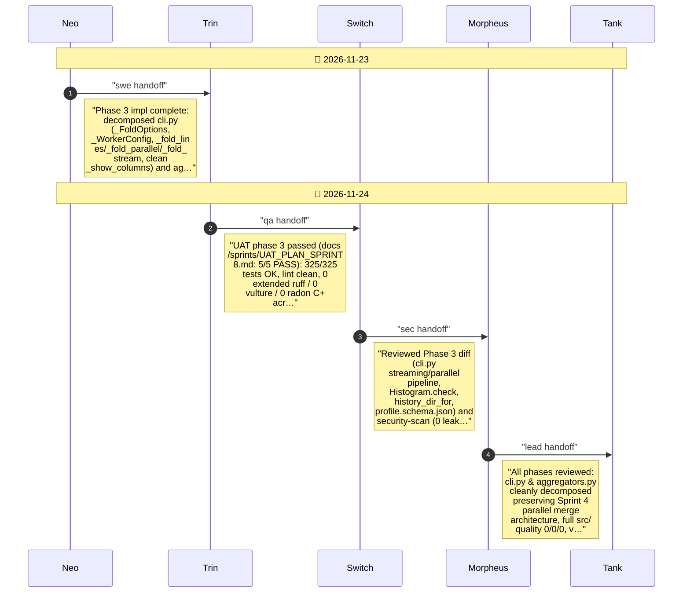
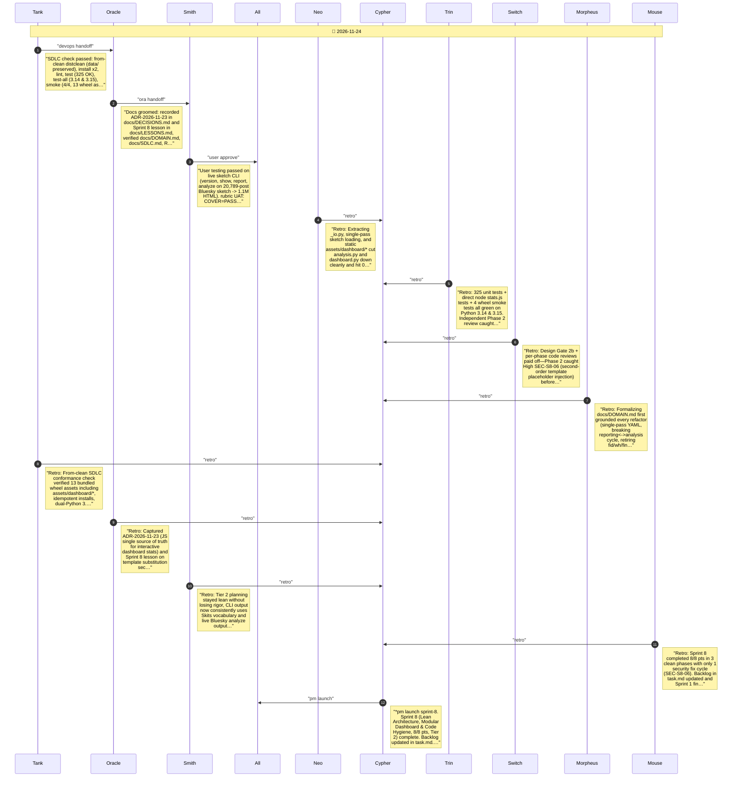

# CHAT_SPRINT_8 — Sprint Archive

## Summary

Sprint 8, Lean Architecture, Modular Dashboard & Code Hygiene (Tier 2, 8 pts, 1 security fix cycle for SEC-S8-06). Formalized docs/DOMAIN.md; added _io.py and single-pass sketch.load_ranked_skits eliminating reporting<->analysis cycle and double YAML reads; slimmed analysis.py to a lean payload builder (ADR-2026-11-23); extracted dashboard.py (3,582L->96L) into 10 static assets/dashboard/* files with single-pass placeholder substitution, hardened CSP, and direct node stats.js unit tests; decomposed cli.py and aggregators.py to 0 extended ruff / 0 vulture / 0 radon C+ across src/; retired legacy fid/wh/fingerprint internal names. Verified: 325 tests on Python 3.14 & 3.15, 4 wheel smoke tests (13 bundled assets), security-scan (0 leaks/0 vulns). Merged locally to main; no push or release.

---

## Planning

```mermaid
%%{init: {"sequence": {"messageFontSize": 14, "noteFontSize": 18, "actorFontSize": 14}}}%%
sequenceDiagram
    autonumber
    participant User
    participant All
    participant Neo
    participant Trin
    participant Morpheus
    participant Switch
    participant Smith
    participant Tank
    participant Bob
    participant Cypher
    participant Mouse
    participant Oracle
    Note over User,Oracle: 📅 2026-11-21
    User->>All: "request"
    Note right of User: "*nit add Boolean type<br/>support (distinct from<br/>enum)"
    Neo->>All: "swe init"
    Note right of Neo: "Neo taking single-change<br/>nit on fix/boolean-<br/>field-type: detect<br/>Boolean fields (distinct<br/>from Enum and Numeric)<br/>in analysis.py and<br/>dashboard…"
    Neo->>Trin: "swe handoff"
    Note right of Neo: "Boolean field type nit<br/>complete: analysis.py<br/>and dashboard.py now<br/>distinguish Boolean<br/>(with true_pct and<br/>false<true min/max) from<br/>Numeric a…"
    Trin->>Morpheus: "qa handoff"
    Note right of Trin: "QA verified boolean-<br/>field-type: IS_PRESENT<br/>TRUE/FALSE, DEFAULT<br/>True/False+NULL,<br/>constant FALSE, and<br/>mixed enum edge cases<br/>all pass (299 tes…"
    Morpheus->>All: "lead approve"
    Note right of Morpheus: "Code review approved for<br/>fix/boolean-field-type:<br/>clean 3-way field_type<br/>(boolean/numeric/enum)<br/>parity between Python<br/>and JS, zero security…"
    User->>All: "request"
    Note right of User: "/bloop add an optional<br/>config for an event time<br/>field (jsonpath). when<br/>provided it uses the<br/>value for that field<br/>instead of run-datetime<br/>so…"
    Neo->>All: "swe impl"
    Note right of Neo: "Starting *impl work-loop<br/>on fix/event-time:<br/>optional profile<br/>`event_time` JSONPath<br/>for historical<br/>first_seen/last_seen.<br/>Why: allow historic…"
    Neo->>Trin: "swe handoff"
    Note right of Neo: "Implemented optional<br/>profile `event_time`<br/>JSONPath with TDD (RED<br/>confirmed -> GREEN 6/6<br/>new tests, 305/305 full<br/>suite, lint clean). Why:<br/>al…"
    Trin->>Switch: "qa handoff"
    Note right of Trin: "UAT event-time passed:<br/>305/305 tests OK (incl.<br/>out-of-order historical<br/>events, multi-run<br/>backfill, TZ<br/>normalization, date-<br/>only, missing/mal…"
    Switch->>Morpheus: "sec handoff"
    Note right of Switch: "Reviewed fix/event-time<br/>diff: JSON Schema + RFC<br/>9535 Path validation,<br/>strict ISO-8601<br/>DatetimeType conversion,<br/>_json_safe + script-safe<br/>JSO…"
    Morpheus->>Smith: "lead handoff"
    Note right of Morpheus: "Code review passed:<br/>clean internal envelope<br/>split in builtin.yaml<br/>preserves<br/>meta.first/last contract<br/>byte-for-byte while<br/>supporting datetim…"
    Smith->>All: "user approve"
    Note right of Smith: "UX verified:<br/>`event_time: $.ts`<br/>mirrors `sequence:`,<br/>`show --sort #quot;FIRST<br/>RUN#quot;` orders historical<br/>dates cleanly, and<br/>`analyze` defaults Rang…"
    User->>All: "request"
    Note right of User: "use it on the blue sky<br/>data"
    Neo->>All: "swe impl"
    Note right of Neo: "Neo wiring event_time:<br/>$.createdAt into example<br/>s/bluesky/profile.yaml,<br/>testing, and rebuilding<br/>full 10-min Bluesky<br/>capture + dashboard in<br/>d…"
    Neo->>Trin: "swe handoff"
    Note right of Neo: "Bluesky profile now uses<br/>event_time: $.createdAt,<br/>rebuilt full 10-min<br/>capture into<br/>data/bluesky-posts-<br/>event-time (20,789<br/>posts, 860 skits,…"
    Trin->>All: "qa approve"
    Note right of Trin: "QA/review approved:<br/>Bluesky event_time<br/>tracks createdAt in meta<br/>.first_seen/last_seen<br/>without changing<br/>identity, 306 tests OK,<br/>lint & gitlea…"
    User->>All: "request"
    Note right of User: "can you add drop-one<br/>ablation analysis to the<br/>report?"
    Neo->>All: "swe impl"
    Note right of Neo: "Starting *impl work-loop<br/>on fix/drop-one-<br/>ablation: add drop-one<br/>field ablation analysis<br/>(skits collapsed,<br/>singletons removed,<br/>singleton-onl…"
    Neo->>Trin: "swe handoff"
    Note right of Neo: "Implemented Drop-One<br/>Field Ablation with TDD<br/>(RED confirmed -> GREEN<br/>308/308 tests, lint,<br/>quality, gitleaks clean)<br/>in analysis.py and<br/>inter…"
    Trin->>Switch: "qa handoff"
    Note right of Trin: "UAT passed: 308/308<br/>tests OK (ablation<br/>accuracy, empty sketch,<br/>node --check), live<br/>Bluesky dashboard<br/>verified (languages<br/>collapses -701 ski…"
    Switch->>Morpheus: "sec handoff"
    Note right of Switch: "Reviewed fix/drop-one-<br/>ablation: Map + length-<br/>prefixed collision-free<br/>composite keys,<br/>textContent DOM<br/>rendering, gitleaks 0<br/>leaks. security…"
    Morpheus->>Smith: "lead handoff"
    Note right of Morpheus: "Code review passed:<br/>clean _ablate_one_field<br/>helper keeps radon <= C,<br/>Python/JS parity<br/>verified. rubric<br/>LOOP_IMPL: TFIRST=S<br/>VERIF=S MODUL=S…"
    Smith->>All: "user approve"
    Note right of Smith: "UX verified: Chromium<br/>preview caught narrow<br/>2-column ablation table<br/>and confirmed full-width<br/>stacked chart + 7-column<br/>table renders cleanly…"
    User->>All: "request"
    Note right of User: "let's add a modifier for<br/>language for is English<br/>so it is captured as a<br/>boolean"
    Neo->>All: "swe impl"
    Note right of Neo: "Neo updating examples/bl<br/>uesky/profile.yaml:<br/>replacing raw languages<br/>field with boolean<br/>is_english<br/>($.langs[?match(@,<br/>'[Ee][Nn](-.*)?')] + I…"
    Neo->>Trin: "swe handoff"
    Note right of Neo: "Replaced raw languages<br/>with boolean is_english<br/>($.langs[?match(@,<br/>'[Ee][Nn](-.*)?')] +<br/>IS_PRESENT) in examples/<br/>bluesky/profile.yaml,<br/>309 te…"
    Trin->>All: "qa approve"
    Note right of Trin: "QA/review approved:<br/>is_english produces<br/>strictly TRUE/FALSE even<br/>on<br/>bilingual/mixed/absent<br/>arrays (10 test cases +<br/>309 full suite OK),<br/>live…"
    User->>All: "request"
    Note right of User: "yes and use all the<br/>views and extras +<br/>sankey"
    Neo->>All: "swe impl"
    Note right of Neo: "Starting *impl work-loop<br/>on fix/correlations-and-<br/>sankey: adding Cramér's<br/>V / Theil's U matrix,<br/>redundancy badges,<br/>correlated value<br/>cluster…"
    Neo->>Trin: "handoff"
    Note right of Neo: "TDD GREEN: 310/310 tests<br/>(incl. node --check,<br/>CSP, XSS), lint, quality<br/>(max radon C(15)),<br/>gitleaks clean, Bluesky<br/>dashboard regenerated &<br/>v…"
    Trin->>Switch: "uat"
    Note right of Trin: "UAT passed on Bluesky<br/>dataset (20,789 obs, 242<br/>skits): redundancy<br/>badges (≡ / ←), Value<br/>Cluster Graph, Theil's U<br/>/ Cramér's V heatmap,<br/>Disc…"
    Switch->>Morpheus: "review"
    Note right of Switch: "security gate<br/>(correlations-sankey):<br/>No blocking findings.<br/>Strict offline CSP<br/>preserved, zero new<br/>dependencies, textConten<br/>t/createElementNS…"
    Morpheus->>Smith: "review"
    Note right of Morpheus: "rubric LOOP_IMPL:<br/>TFIRST=S VERIF=S MODUL=S<br/>REGRESS=S BUDGET=S —<br/>clean modular<br/>correlation helpers (max<br/>radon C(15)), full test<br/>coverage, ze…"
    Smith->>All: "review"
    Note right of Smith: "UX sign-off: All Fields<br/>Diagnostics column fits<br/>cleanly at 1280px,<br/>radial graph and Sankey<br/>flow labels are legible<br/>with click-to-filter<br/>par…"
    Neo->>Neo: "impl start"
    Note right of Neo: "User request: /bloop<br/>auto-discovered additive<br/>aggregate weightings in<br/>dashboard (Weight by<br/>selector re-weighting<br/>KPIs, Pareto, field<br/>distri…"
    Neo->>Trin: "handoff"
    Note right of Neo: "TDD GREEN: 312/312 tests<br/>(incl. weightings<br/>discovery, --weight CLI,<br/>URL hash state, node<br/>--check, CSP, XSS),<br/>lint, quality (max radon<br/>C(18)…"
    Trin->>Switch: "uat"
    Note right of Trin: "UAT passed on Bluesky<br/>dataset: auto-discovered<br/>additive weightings<br/>(images_bytes,<br/>text_bytes,<br/>images_count,<br/>facet_features, etc.)<br/>re-weight…"
    Switch->>Morpheus: "review"
    Note right of Switch: "security gate<br/>(dashboard-weightings):<br/>No blocking findings.<br/>Strict offline CSP<br/>unchanged, zero external<br/>network calls, URL hash<br/>params allo…"
    Morpheus->>Smith: "review"
    Note right of Morpheus: "rubric LOOP_IMPL:<br/>TFIRST=S VERIF=S MODUL=S<br/>REGRESS=S BUDGET=S —<br/>clean additive<br/>weightings discovery<br/>(_discover_weightings<br/>C(18)), continuou…"
    Smith->>All: "review"
    Note right of Smith: "UX sign-off: Weight by<br/>selector, active weight<br/>chip, Copy View Link<br/>button, dynamic<br/>column/axis labels, and<br/>hash restoration<br/>verified visua…"
    Neo->>Neo: "impl start"
    Note right of Neo: "User selected Option 2:<br/>mergeable per-event<br/>HISTOGRAM aggregator<br/>(auto log-decimal bins +<br/>explicit fixed buckets,<br/>schema validation,<br/>analys…"
    Neo->>Trin: "handoff"
    Note right of Neo: "TDD GREEN: 317/317 tests<br/>(incl. log-decimal &<br/>fixed-bucket HISTOGRAM,<br/>merge associativity,<br/>quantiles, node --check,<br/>CSP, XSS), lint, qualit…"
    Trin->>Switch: "uat"
    Note right of Trin: "UAT passed on Bluesky<br/>20,789-post capture:<br/>text_bytes (p50≈101,<br/>p90≈278, p95≈359,<br/>p99≈769) and<br/>images_bytes (3,617<br/>images, p50≈562KB,<br/>p99≈1…"
    Switch->>Morpheus: "review"
    Note right of Switch: "security gate<br/>(histogram-aggregator):<br/>No blocking findings.<br/>Strict JSON Schema<br/>validation for HISTOGRAM<br/>buckets (finite non-bool<br/>strictly i…"
    Morpheus->>Smith: "review"
    Note right of Morpheus: "rubric LOOP_IMPL:<br/>TFIRST=S VERIF=S MODUL=S<br/>REGRESS=S BUDGET=S —<br/>associative sparse log-<br/>decimal & fixed-bucket<br/>HISTOGRAM aggregator,<br/>clean p…"
    Smith->>All: "review"
    Note right of Smith: "UX sign-off: Aggregates<br/>table fits cleanly at<br/>1280px without<br/>horizontal clipping,<br/>Per-Event Histogram with<br/>quantile badges and<br/>cumulative %…"
    Neo->>All: "done"
    Note right of Neo: "Replaced Bluesky<br/>is_english with boolean<br/>is_multi_lang<br/>($.langs[1] +<br/>IS_PRESENT), 317/317<br/>tests and lint green,<br/>rebuilt data/bluesky-<br/>posts-…"
    Neo->>Tank: "start"
    Note right of Neo: "Owner requested changing<br/>CLI command from<br/>sketchtastic to sketch<br/>(keeping skt alias,<br/>distribution sketch-<br/>tastic and import<br/>sketchtastic unc…"
    Tank->>All: "devops sdlc"
    Note right of Tank: "SDLC update verified:<br/>CLI command renamed to<br/>sketch only<br/>(pyproject.toml,<br/>Makefile CLI,<br/>docs/SDLC.md). make<br/>install, lint, 317/317<br/>tests, 4…"
    Note over User,Oracle: 📅 2026-11-22
    Neo->>Neo: "impl start"
    Note right of Neo: "User requested simple<br/>streaming processing as<br/>events arrive with timed<br/>limit (--max-seconds)<br/>and count limit (--max-<br/>events) on sketch merge…"
    Neo->>Trin: "handoff"
    Note right of Neo: "TDD GREEN: 322/322 tests<br/>(incl. live open-pipe<br/>--max-events and --max-<br/>seconds tests + capture<br/>--output -), lint,<br/>quality (zero radon<br/>D/E/F)…"
    Trin->>Switch: "uat"
    Note right of Trin: "UAT passed: streaming<br/>stdin processes events<br/>line-by-line immediately<br/>without 5000-line head<br/>buffering, --max-events<br/>and --max-seconds stop…"
    Switch->>Morpheus: "review"
    Note right of Switch: "security gate<br/>(streaming-limits): No<br/>blocking findings.<br/>Finite positive<br/>validation on --max-<br/>events/--max-seconds,<br/>zero new deps, bounded<br/>40…"
    Morpheus->>Smith: "review"
    Note right of Morpheus: "rubric LOOP_IMPL:<br/>TFIRST=S VERIF=S MODUL=S<br/>REGRESS=S BUDGET=S —<br/>clean select+os.read<br/>pipe iterator avoids<br/>BufferedReader deadlock,<br/>batch pa…"
    Smith->>All: "review"
    Note right of Smith: "UX sign-off: simple Unix<br/>pipeline semantics<br/>(capture | sketch merge<br/>--max-seconds/--max-<br/>events) with clear stop-<br/>reason output. Approved<br/>for…"
    Note over User,Oracle: 📅 2026-11-23
    User->>All: "request"
    Note right of User: "$bob-protocol init time<br/>for a tech debt sprint"
    Bob->>All: "ready"
    Note right of Bob: "Bob Protocol<br/>initialized. Team ready."
    Bob->>All: "greeting"
    Note right of Bob: "Good morning, team! What<br/>is your favorite part of<br/>your job? Why: a quick<br/>check-in starts the day<br/>together."
    Bob->>All: "greeting"
    Note right of Bob: "Refining a skill until<br/>the rubric can actually<br/>see good judgment and<br/>every persona knows its<br/>exact boundary. Why:<br/>clear roles let the<br/>workf…"
    Cypher->>All: "greeting"
    Note right of Cypher: "Turning a fuzzy idea<br/>into crisp acceptance<br/>criteria that everyone<br/>can observe and agree<br/>on. Why: starting with<br/>the user outcome keeps<br/>scope…"
    Morpheus->>All: "greeting"
    Note right of Morpheus: "Naming the boundaries<br/>and invariants before<br/>anyone draws the boxes,<br/>then watching a complex<br/>problem collapse into a<br/>simple design. Why: cla…"
    Mouse->>All: "greeting"
    Note right of Mouse: "Slicing big ambitions<br/>into small, dependency-<br/>ordered batches in<br/>task.md and clearing<br/>blockers before they<br/>slow the team down. Why:<br/>small ba…"
    Neo->>All: "greeting"
    Note right of Neo: "Watching a failing<br/>reproduction test turn<br/>green after the<br/>smallest, cleanest<br/>change that proves the<br/>fix. Why: running<br/>software and passing…"
    Oracle->>All: "greeting"
    Note right of Oracle: "Tracing a tricky<br/>question back to its<br/>source and filing the<br/>answer right where the<br/>next person will look<br/>for it. Why: durable,<br/>accurate doc…"
    Smith->>All: "greeting"
    Note right of Smith: "Running the real CLI and<br/>UI myself to spot<br/>friction and test error<br/>recovery before users<br/>hit it. Why: an<br/>interface should make<br/>the next ste…"
    Switch->>All: "greeting"
    Note right of Switch: "Catching a risky<br/>assumption or vulnerable<br/>dependency early and<br/>pairing the evidence<br/>with a clean, easy-to-<br/>adopt fix. Why: least<br/>privilege a…"
    Tank->>All: "greeting"
    Note right of Tank: "Turning one-off setup<br/>steps into declarative,<br/>repeatable Makefile<br/>targets that behave the<br/>same from a clean<br/>checkout every time.<br/>Why: repea…"
    Trin->>All: "greeting"
    Note right of Trin: "Backing every quality<br/>gate with a fast,<br/>deterministic test<br/>against real behavior<br/>instead of a fragile<br/>guess. Why: coverage<br/>should follow ri…"
    User->>All: "request"
    Note right of User: "Option 1: Full tech-debt<br/>audit first to propose a<br/>scoped Tier 2 Sprint 8<br/>plan."
    Bob->>Morpheus: "handoff"
    Note right of Bob: "User requested full<br/>tech-debt audit before<br/>scoping Sprint 8 (Tier<br/>2). @Morpheus *lead<br/>audit tech-debt"
    Morpheus->>All: "lead init"
    Note right of Morpheus: "Activating for Sprint 8<br/>tech-debt audit: running<br/>bobp make quality and<br/>surveying src/, tests/,<br/>docs/, and backlog. Why:<br/>evidence-driven pri…"
    Morpheus->>User: "lead audit"
    Note right of Morpheus: "Tech-debt audit<br/>complete: 35 extended<br/>ruff issues, 19 radon<br/>C/D functions (worst:<br/>_value_cooccurrence<br/>D(24)), 3,582-line<br/>dashboard.py monol…"
    Morpheus->>User: "lead advise"
    Note right of Morpheus: "Advised owner on 3<br/>architecture questions:<br/>(1) dashboard.py NEVER<br/>reads DATA.ablation/corr<br/>elations/concentration<br/>or computed field/agg<br/>stat…"
    User->>All: "request"
    Note right of User: "yes and I agree with<br/>keep lean /sprint plan &<br/>impl sprint 8"
    Cypher->>Smith: "pm handoff"
    Note right of Cypher: "Tier 2 Sprint 8 combined<br/>stories + architecture<br/>drafted in docs/sprints/<br/>USER_STORIES_SPRINT8.md<br/>(STORY-SKT-15..18, 8<br/>pts) and domain model…"
    Smith->>Switch: "user approve"
    Note right of Smith: "*user approve. rubric<br/>STORIES: OUT=PASS<br/>TEST=PASS FAIL=PASS<br/>SCOPE=PASS SIZE=PASS<br/>DESIGN=PASS | rubric<br/>ARCH: BOUND=PASS<br/>FLOW=PASS FAIL=PASS…"
    Switch->>Mouse: "sec handoff"
    Note right of Switch: "Reviewed Sprint 8 design<br/>& gitleaks hook<br/>(.githooks active, 0<br/>accepted risks). Fixed-<br/>allowlist asset loading<br/>via importlib.resources,<br/>atomi…"
    Mouse->>Morpheus: "sm handoff"
    Note right of Mouse: "Sprint 8 task board<br/>ready in task.md (3<br/>bounded phases +<br/>closeout, L1-L3 levels,<br/>Switch gates after every<br/>coding phase, Tank sdlc-<br/>check at…"
    Morpheus->>Neo: "lead handoff"
    Note right of Morpheus: "Sprint plan approved.<br/>rubric PLAN: SIZE=PASS<br/>GATE=PASS VERIF=PASS<br/>ALIGN=PASS OWNER=PASS<br/>LEVEL=PASS. Phase 1<br/>ready. @Neo *swe impl<br/>phase-1"
```

---

## Phase 1

Phase 1: Shared internal I/O & single-pass ranked sketch loading, acyclic reporting/analysis boundaries, and lean analysis.py payload builder.



---

## Phase 2

Phase 2: Extract dashboard.py CSS/HTML/JS monolith into modular static assets under src/sketchtastic/assets/dashboard/ with direct node unit tests for stats.js.



---

## Phase 3

Phase 3: Decompose cli.py merge pipeline and aggregators.py histogram helpers to <= radon B / 0 extended ruff, and retire legacy fid/wh/fingerprint internal identifiers.



---

## Close

Stage 3 Sprint Closeout: Tank SDLC conformance check, Oracle documentation grooming & chat report, Smith usability testing, team retrospective, and Cypher launch.



## Sprint close-out

- **Cypher**: \*pm launch sprint-8. Sprint 8 (Lean Architecture, Modular Dashboard &amp; Code Hygiene, 8/8 pts, Tier 2) complete. Backlog updated in task.md.…
