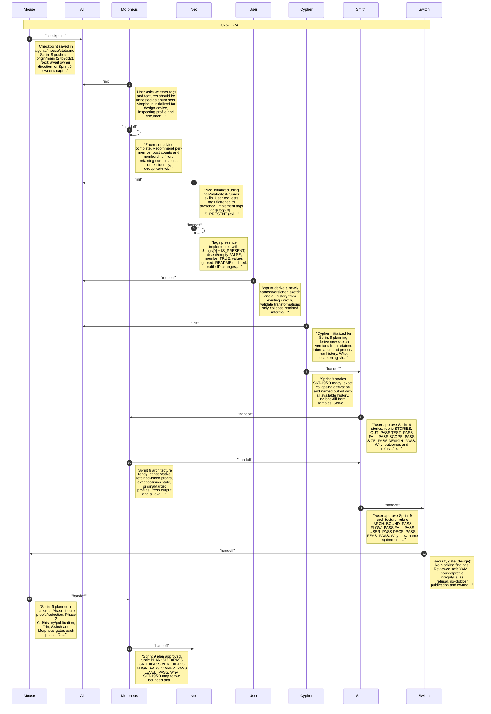
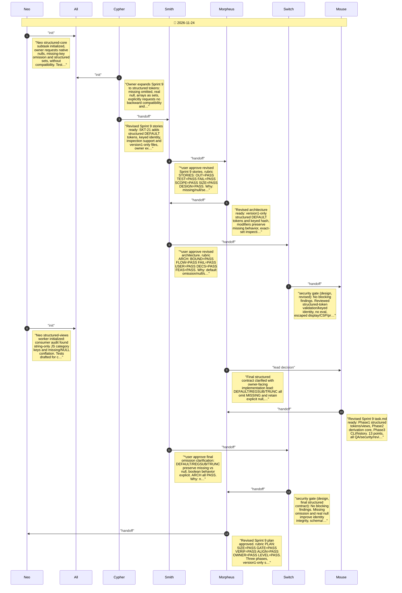
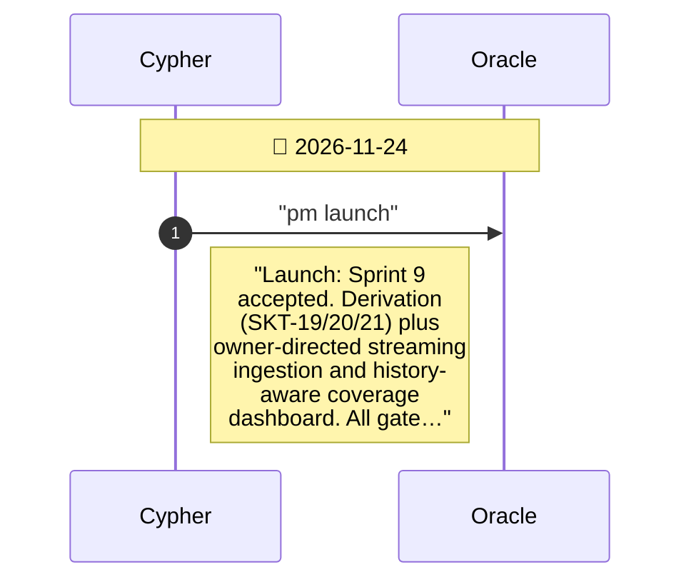

# CHAT_SPRINT_9 — Sprint Archive

## Summary

Sprint 9 delivered structured version-1 tokens and validated sketch derivation with transformed history (SKT-19/20/21, phases 1-3). During closeout the owner redirected the Bluesky example and reporting: capture now streams through a stdin/stdout unwrap filter into sketch merge (prepare removed), the ASCII report and coverage commands were folded into the analyze dashboard with history-aware regression coverage, and BobProtocol was updated to 0.3.1. All gates passed; integrated locally, not pushed.

---

## Planning

---

## Phase 1

Sprint 9 Phase 1: prove supported retained-token collapses, validate complete states, rekey and merge collisions with exact statistics. Why: establish derivation correctness before filesystem publication.

---

## Phase 1

Sprint 9 revised Phase 1: structured tokens, keyed identities, version1-only reader and exact-set inspection/filtering. Why: retain missing/null/set information before derivation. Earlier Phase1 derivation marker is superseded by owner-expanded scope.

```mermaid
%%{init: {"sequence": {"messageFontSize": 14, "noteFontSize": 18, "actorFontSize": 14}}}%%
sequenceDiagram
    autonumber
    participant Neo
    participant All
    participant Trin
    participant Switch
    participant Morpheus
    participant Tank
    participant Oracle
    participant Mouse
    participant Smith
    participant Drew
    Note over Neo,Drew: 📅 2026-11-24
    Neo->>All: "init"
    Note right of Neo: "Neo executing revised<br/>Sprint9 structured<br/>tokens and derivation.<br/>Tests first captured<br/>missing derive module<br/>and structured token<br/>failures. O…"
    Neo->>Trin: "handoff"
    Note right of Neo: "Structured core ready:<br/>native nulls/sets,<br/>omitted missing value<br/>fields, keyed IDs,<br/>version1 refusal and<br/>derivation provenance.<br/>Red proved f…"
    Neo->>Neo: "handoff"
    Note right of Neo: "Structured views<br/>complete: canonical keys<br/>distinguish missing/null<br/>/literal/arrays, exact-<br/>set stats, filters,<br/>correlations and Sankey,<br/>struc…"
    Neo->>Trin: "handoff"
    Note right of Neo: "Core validation follow-<br/>up complete: ordinary<br/>load now rejects<br/>noncanonical arrays,<br/>invalid token shapes and<br/>mismatched IDs, ranked<br/>loading…"
    Trin->>All: "init"
    Note right of Trin: "Trin reviewing Sprint 9<br/>derivation/history<br/>implementation<br/>independently against<br/>SKT-19/20. Findings sent<br/>to Neo: required<br/>modifier token om…"
    Trin->>Switch: "handoff"
    Note right of Trin: "Phase1 inspection slice<br/>UAT PASS: dashboard12 +<br/>analysis10 +<br/>reporting17. Verified<br/>distinct<br/>missing/null/literal/set<br/>keys, filter producer…"
    Switch->>Morpheus: "handoff"
    Note right of Switch: "security gate (phase1<br/>inspection): No blocking<br/>findings. Native JSON<br/>keys and textContent/CSP<br/>remain safe, 39 targeted<br/>tests and git-aware…"
    Morpheus->>Neo: "handoff"
    Note right of Morpheus: "Phase1 inspection<br/>architecture APPROVED<br/>after Trin/Switch:<br/>shared canonical<br/>identity keys, display<br/>labels and exact-set<br/>semantics consisten…"
    Neo->>Tank: "handoff"
    Note right of Neo: "Neo structured views<br/>state saved, root<br/>requested Tank SDLC<br/>closeout after phase<br/>commits. @Tank *devops<br/>sdlc-check Sprint9"
    Tank->>All: "init"
    Note right of Tank: "Tank initialized for<br/>Sprint9 closeout using<br/>tank/build-env skills.<br/>Will preserve original<br/>data and .venv in<br/>sibling backup, verify<br/>clean bu…"
    Trin->>Switch: "handoff"
    Note right of Trin: "Sprint9 phase1 core +<br/>phases2/3 UAT PASS,<br/>UAT-S9-01..07 all PASS.<br/>Full364/lint green,<br/>quality0, derive help<br/>executed, actual5->2<br/>skits reta…"
    Switch->>Morpheus: "handoff"
    Note right of Switch: "security gate (phase1<br/>core, phase2, phase3):<br/>No blocking findings.<br/>Structured validation,<br/>exact collapse/state<br/>guards, sequence<br/>integrity a…"
    Morpheus->>Tank: "handoff"
    Note right of Morpheus: "Sprint9 phase1 core +<br/>phases2/3<br/>architecture/code<br/>APPROVED after<br/>Trin/Switch. Proof<br/>rules, keyed structured<br/>identities, exact stats<br/>and his…"
    Tank->>Oracle: "handoff"
    Note right of Tank: "Sprint9 SDLC check PASS:<br/>clean install x2,<br/>lint40, tests364 on<br/>3.14/3.15, smoke4,<br/>security131 commits/0<br/>leaks/0 vulns,<br/>lock/config checks.…"
    Oracle->>All: "init"
    Note right of Oracle: "Oracle initialized for<br/>Sprint9 close grooming<br/>after commits<br/>c7d53ec/d51518f/b9f4484.<br/>Recording structured<br/>format, derivation proof<br/>and hist…"
    Oracle->>Mouse: "handoff"
    Note right of Oracle: "Sprint9 docs groomed:<br/>DOMAIN<br/>derivation/structured<br/>invariants,<br/>ADR-2026-11-24 and<br/>retained-information<br/>lesson recorded. Groom<br/>ACCURACY/USAB…"
    Mouse->>Smith: "handoff"
    Note right of Mouse: "Sprint9 phases marked<br/>complete with<br/>c7d53ec/d51518f/b9f4484,<br/>closeout remains in<br/>progress pending Tank.<br/>Inherited<br/>correlation/URL field-<br/>nam…"
    Tank->>All: "review"
    Note right of Tank: "Tank followup review:<br/>post-link interruption<br/>cleanup changes only<br/>derive_io and one<br/>regression test, no mech<br/>anism/dependency/environ<br/>ment im…"
    Morpheus->>Drew: "advise"
    Note right of Morpheus: "Root cause: Bluesky<br/>example grew a second,<br/>batch-shaped ingest path<br/>beside core 'sketch<br/>merge' (which streams<br/>stdin, back-pressure,<br/>history…"
    Morpheus->>Drew: "review"
    Note right of Morpheus: "Arch/domain review done.<br/>Gap: DOMAIN had no rule<br/>that sketch merge is the<br/>only ingestion path, so<br/>prepare slipped through<br/>review. Added DOM…"
    Morpheus->>Drew: "decide"
    Note right of Morpheus: "Owner: one report (DRY).<br/>Removed sketch report +<br/>reporting.report, tests<br/>ported to coverage<br/>listing, README/example<br/>README/SDLC/DOMAIN upda…"
    Morpheus->>Drew: "review"
    Note right of Morpheus: "Coverage folded into<br/>analyze (--regression<br/>FILE -p PROFILE),<br/>history aware: per-run +<br/>cumulative kind/weighted<br/>coverage and new<br/>uncovered k…"
    Oracle->>Tank: "groom"
    Note right of Oracle: "Groom: README contents +<br/>doc index, Bluesky ASCII<br/>heading fixed, dead<br/>lesson refs annotated,<br/>ADR-24-c/-d options<br/>added.<br/>ACCURACY/USABILITY/…"
    Trin->>Morpheus: "qa verify"
    Note right of Trin: "Phase 4 verify:<br/>unwrap/capture/coverage<br/>tests<br/>(test_bluesky_unwrap,<br/>test_bluesky_capture,<br/>test_coverage) cover<br/>streaming flush, bounded<br/>ded…"
    Switch->>Morpheus: "security gate"
    Note right of Switch: "security gate (phase 4):<br/>No blocking findings.<br/>Strict bounded JSON<br/>parsing in<br/>unwrap/coverage,<br/>exclusive (mode x)<br/>capture/sidecar<br/>creation,…"
    Morpheus->>Tank: "lead review"
    Note right of Morpheus: "Phase 4 approved:<br/>matches<br/>ADR-2026-11-24-b/-c/-d<br/>and DOMAIN ingestion<br/>invariants. Committed<br/>7f0c334, 8717718,<br/>ea420ba, 2b074f0,<br/>c4e1e88, e9…"
    Smith->>Mouse: "user approve"
    Note right of Smith: "*user approve. Sprint 9<br/>runtime UAT R1-R7 PASS<br/>on real 30-min Bluesky<br/>data: derive 349->186<br/>skits, 207,882 obs<br/>preserved, refinement<br/>and cl…"
    Tank->>Mouse: "devops sdlc-check"
    Note right of Tank: "sdlc-check PASS (re-run<br/>after Phase 4):<br/>distclean/install x2/lin<br/>t/test/secrets/build,<br/>test-all 364 on<br/>3.14+3.15, smoke 4,<br/>quality 0/0/0, se…"
    Mouse->>Oracle: "sm retro"
    Note right of Mouse: "Retro S9: Went well:<br/>derivation shipped with<br/>strong refusal/rollback<br/>guarantees, real-data<br/>UAT. Went wrong:<br/>examples grew a batch<br/>side path…"
```

---

## Phase 2

Phase 2 (recorded at close; marker missed during the phase): validated collapsing transform and state reduction, committed d51518f.

_No messages in this phase._

---

## Phase 3

Phase 3 (recorded at close; marker missed during the phase): derive CLI, history and safe publication, committed b9f4484; follow-up fix 7f0c334.

_No messages in this phase._

---

## Phase 4

Phase 4 (owner-directed during closeout): one streaming ingestion path (capture|unwrap|sketch merge), dashboard as the one report, history-aware coverage. Commits 8717718, ea420ba, 2b074f0, c4e1e88, 8182371; bobp 0.3.1 e9fe318.

## Sprint close-out

- **Cypher**: Launch: Sprint 9 accepted. Derivation (SKT-19/20/21) plus owner-directed streaming ingestion and history-aware coverage dashboard. All gate…
