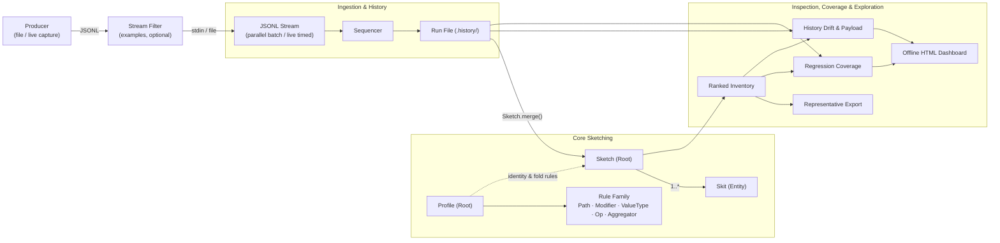
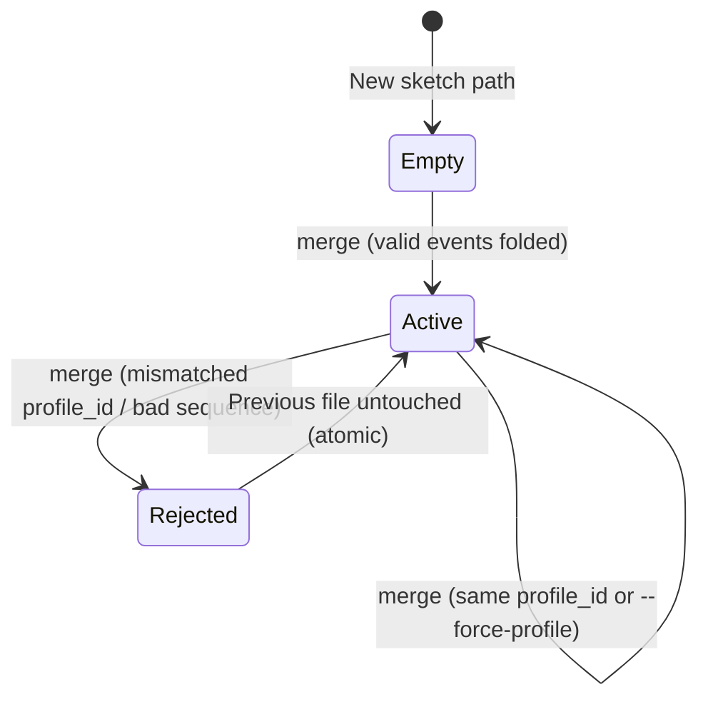

# Domain Model: sketch-tastic

*   **Bounded Contexts**: `Core Sketching`, `Ingestion & History`, `Inspection, Coverage & Exploration`
*   **Status**: Active
*   **Domain Owners**: Cypher (`*pm`), Morpheus (`*lead`)
*   **Last Updated**: 2026-11-24

---

## 1. Executive Summary & Strategic Context

`sketch-tastic` reduces high-volume JSONL event streams into compact, human-readable, mergeable YAML **sketches** for regression testing and flow analysis. Each distinct shape of event becomes one **skit** with counts, user-defined statistics, and retained original samples.

* **In-Scope Capabilities:** Profile validation and structured tokenization (`fields`), associative per-skit aggregation (`aggregates` + built-in `meta`), monotonic sequence deduplication, streaming and parallel folding, run history snapshots and drift comparison, validated sketch derivation with transformed history, representative sample export, baseline-weighted regression coverage, and offline interactive HTML dashboard generation.
* **Out-of-Scope:** Application-specific event normalization (examples live outside the core package under `examples/` and may only be **stream filters** in front of `sketch merge`), external telemetry collectors or servers, browser build toolchains, and backwards-compatible schema migrations before v1.0.
* **Upstream Contexts:** External JSONL event producers (log streams, trace pipelines, public firehose captures) and user-authored YAML profiles.
* **Downstream Consumers:** Regression test suites consuming exported JSONL samples and coverage reports, engineers inspecting the offline HTML dashboard (`sketch analyze`, the one kind report) or a quick terminal table (`sketch show`), and Python callers importing the `sketchtastic` library.

---

## 2. Ubiquitous Language (Glossary)

| Business Term | Kind | Definition in this context | Code Mapping |
|---|---|---|---|
| **Event** | Value Object | One raw JSON object from an input JSONL stream. | `dict[str, Any]` |
| **Path** | Value Object | A compiled RFC 9535 JSONPath expression selecting zero or more values from an Event. | `sketchtastic.model.Path` |
| **Rule** | Value Object (base) | A schema-validated, immutable named behavior (`Modifier`, `ValueType`, `Op`, or `Aggregator`). | `sketchtastic.model.Rule` |
| **Modifier** | Value Object | Reduces one selected value (or `MISSING`) to a deterministic structured token (string, null or array; missing value fields omitted) (`DEFAULT`, `IS_PRESENT`, `IS_NULL`, `IN_RANGE`, `ANY`, `GLOB`, `REGEX`, `REGSUB`, `TRUNC`). | `sketchtastic.model.Modifier` |
| **ValueType** | Value Object | Parses and normalizes raw text into comparable UTC typed values (`DATETIME`, `DATE`). | `sketchtastic.model.ValueType` |
| **Op** | Value Object | Transforms a selected value into a derived measurement before aggregation (`SIZE` in UTF-8 / compact JSON bytes). | `sketchtastic.aggregators.Op` |
| **Aggregator** | Value Object | An associative monoid `(initial, accept, fold, merge)` over YAML-serializable state (`SUM`, `MIN`, `MAX`, `AVG`, `COUNT`, `FIRST`, `LAST`, `HISTOGRAM`). | `sketchtastic.aggregators.Aggregator` |
| **Field** | Value Object | One identity dimension `(key, Path, Modifier, ValueType?)`; multi-match tokens are deduplicated and sorted as structured arrays. | `sketchtastic.model.Field` |
| **Structured Token** | Value Object | A string, real null, or recursively canonical array set; missing value-producing fields are omitted from the token mapping. | `sketchtastic.model.Token` / `canonical_set` |
| **Aggregate** | Value Object | One per-skit statistic or sample specification `(key, Path, fn, Op?, ValueType?)`; never affects identity. | `sketchtastic.aggregators.Aggregate` |
| **Profile** | Aggregate Root | Immutable specification of `fields`, `aggregates`, optional `sequence`, and optional `event_time`. | `sketchtastic.profile.Profile` |
| **Skit** | Entity | One distinct observed event shape keyed by `skit_id`, holding `tokens`, `aggregates`, `meta`, and derived `share`. | `sketchtastic.sketch.Skit` |
| **Sketch** | Aggregate Root | Persistent, mergeable inventory of `Skit`s tied to one `profile_id`, `last_run`, and optional `sequence` high-water mark. | `sketchtastic.sketch.Sketch` |
| **Stream Filter** | Upstream Adapter | An application-side stdin→stdout JSONL transform (e.g. unwrapping capture envelopes) that runs in front of `sketch merge`, writes each output line as it reads, and holds bounded state. It never folds, saves or publishes sketches. | `examples/*` (e.g. `examples.bluesky.unwrap`) |
| **Run** | Value Object | One merge invocation identified by monotonic UTC `YYMMDD-SEQ`, persisted as a standalone sketch in `<sketch>.history/<run_id>.yaml`. | `sketchtastic.cli` / `Sketch.run` |
| **Sequencer** | Domain Service | Guards against duplicate ingestion using `Profile.sequence` and `Sketch.sequence.max`; rejects missing or non-numeric sequence values atomically. | `sketchtastic.cli._Sequencer` |
| **Derivation** | Domain Service | Creates a separately named sketch by proving each retained source skit maps to exactly one target skit, merging collisions and transforming every available history run. | `sketchtastic.derive` / `derive_io` |
| **Collapsing Transform** | Value Object | A supported field mapping that preserves or reduces distinctions and agrees with target-profile tokenization; cannot infer unseen event detail. | `sketchtastic.derive.FieldTransform` |
| **Derivation Provenance** | Value Object | Source path plus source/target profile IDs stored in the output and retained by later merges. | `Sketch.derivation` |
| **Ranked Inventory** | Read Model | Validated `(skit_id, Skit)` entries ordered by descending `meta.count` (tie-break by `skit_id`). | `sketchtastic.sketch.load_ranked_skits` |
| **Regression Coverage** | Domain Service | Intersects candidate regression JSONL records (tokenized under the baseline `Profile`) against a baseline `Sketch` and each history run, reporting distinct-kind and baseline-frequency-weighted coverage separately, per run and cumulatively, plus kinds each run introduced that the corpus misses. Shown only in the dashboard (`analyze --regression`). | `sketchtastic.coverage` |
| **History Drift** | Read Model | Run-over-run comparison of `new_skits`, `disappeared_skits`, and `top_shifts` across `<sketch>.history/`. | `sketchtastic.analysis` |
| **Dashboard** | Presentation | Self-contained offline HTML + vendored Chart.js explorer computing live filtered/re-weighted statistics client-side from embedded `DATA.skits`. | `sketchtastic.dashboard` + `assets/dashboard/` |

### Alternative or Deprecated Terms

| Deprecated Term | Preferred Ubiquitous Term | Rationale |
|---|---|---|
| `fingerprint` / `fid` | `skit` / `skit_id` (or `sid`) | Renamed in Sprint 1 (2026-10-14); old `fingerling` terminology obscures the skit/sketch vocabulary. |
| `warehouse` / `wh` | `sketch` | Legacy `fingerling` storage name replaced by `Sketch`. |
| `sketchtastic` (as CLI command) | `sketch` | CLI entrypoint renamed to `sketch` (2026-11-21); `sketchtastic` remains the Python import name and `sketch-tastic` the PyPI distribution. |

---

## 3. Context Map and Model

### Entities vs. Value Objects Summary
* **Entities (Identity-based):**
  * `Skit`: Identity defined by `skit_id` (MD5 of JSON-encoded key/value pairs in profile order). Mutable aggregate/meta state accumulated across observations.
  * `Sketch`: Persistent inventory identified by its file path and guarded by `profile_id`. Mutable across merges, saved atomically.
* **Value Objects (Attribute-based):**
  * `Path`, `Rule` (`Modifier`, `ValueType`, `Op`, `Aggregator`), `Field`, `Aggregate`, `Profile`, `Run` header: Immutable (`frozen=True`); equality by value.

---

## 4. Aggregates & Business Invariants

### Aggregate Root: `Profile`
* **Root:** `Profile`
* **Boundary Members:** `Field` tuple, `Aggregate` tuple, `Path` (`sequence`, `event_time`), `Rule` instances.
* **Business Invariants (Must ALWAYS Be True):**
  1. *Schema & semantic validity:* Every `Profile` passes `profile.schema.json` plus semantic checks (valid JSONPath, valid regex/replace, `low <= high`, strictly increasing finite `HISTOGRAM` buckets, `TRUNC` paired with `DATE`/`DATETIME`, unique keys per section).
  2. *Identity stability:* `profile_id` hashes `fields` in profile order only. Adding, removing, or modifying `aggregates`, `sequence`, or `event_time` never changes `profile_id`.
  3. *Order-independent multi-match:* When a `Field`'s `Path` matches multiple values on one event, tokens are deduplicated and sorted as structured arrays so array ordering never creates spurious skits.
  4. *Missing/null/set distinction:* DEFAULT, REGSUB and TRUNC omit missing results and retain
     explicit null. DEFAULT directly selected arrays remain arrays, including empty/singleton
     arrays, with recursive sorting/deduplication. Multiple matches reduce to a scalar when only
     one unique value remains. Boolean modifiers retain their explicit TRUE/FALSE behavior.

### Ingestion: one streaming path
1. *Single entry:* Events enter a sketch only through `sketch merge` (a file, or stdin as lines
   arrive). Nothing else builds a sketch from events; application code may only add stream
   filters in front of it, and selects features only in the profile.
2. *Constant memory in the stream length:* Every ingestion stage writes each record as it reads
   it. Per-event state that would grow with the stream (e.g. deduplication sets) is bounded;
   state may grow only with the number of skits.
3. *Partial results are honest:* A stage that stops early keeps what it already wrote and
   records why (`stop_reason`, exit status); it never discards data already captured.

### Aggregate Root: `Sketch`
* **Root:** `Sketch`
* **Boundary Members:** `Skit` map (`skits`), `profile_id`, `last_run`, `sequence` high-water mark, optional `run` and `derivation` headers, built-in `meta` (`builtin.yaml`).
* **Business Invariants (Must ALWAYS Be True):**
  1. *Token-ID integrity:* Every skit key equals `skit_id(skit.tokens)`, computed from structured key/value pairs in profile order.
  2. *Profile-ordered completeness:* Every `Skit` contains every profile aggregate and every built-in `meta` entry in profile order from its first event on.
  3. *Associative merge:* Splitting events across runs or parallel workers and merging via `Sketch.merge()` yields exact equality for `count`, `SUM`, `COUNT`, `MIN`, `MAX`, `AVG`, `HISTOGRAM`, `first_seen`/`last_seen`, and `sequence` bounds.
  4. *Profile guard:* Loading or merging refuses a mismatched `profile_id` unless `--force-profile` is explicitly passed.
  5. *Derived shares & atomic save:* `share` is recomputed on save and never folded. Disk writes use atomic replacement and never follow symlinks.
  6. *Statistical honesty (Inspection context):* Observation-weighted metrics (`AVG.sum / AVG.count`, `HISTOGRAM` quantiles) are kept distinct from across-skit summaries; coverage measures observed-baseline representation only.
  7. *Format boundary:* Sketch format 1 stores structured tokens and keyed identities. Format 0
     is rejected without compatibility/migration; the owner accepted recapture. Profile format
     remains version 0 because its schema did not change.

### Domain Service: `Derivation`

1. *Conservation:* Every source skit produces one target identity; collisions merge. Observation
   totals are preserved and skit counts cannot increase. Shares are recomputed.
2. *Provability:* The original and target profiles must have identical aggregate, sequence and
   event-time specifications. Supported field mappings preserve selection paths/types and use
   explicit collapse proofs. Missing dimensions, refinements and unsupported mappings reject.
3. *Retained-state integrity:* Validate profile identity, keyed tokens, required predicate
   fields, complete aggregate/built-in state, histogram bins and continuation marks before
   reduction. Representative samples never stand in for population evidence.
4. *History independence:* Transform the main sketch and each available history run separately;
   incomplete history never replaces the main inventory. Preserve run IDs/times/counts and
   high-water marks; do not invent missing runs or a new capture run.
5. *Publication ownership:* Require unused output and companion history paths. Validate and
   stage the entire bundle first, publish the main file last without clobbering, and clean only
   operation-owned files on handled errors. Source files remain unchanged and must be quiescent.
6. *Honest limits:* FIRST/LAST remain bounded representative samples; cross-skit event order
   cannot be reconstructed. Mixed-kind extrema reject rather than losing values. Publication
   across two paths is not a crash-atomic filesystem transaction.

---

## 5. Lifecycle

A `Sketch` file follows a simple append-and-merge lifecycle:

### State Transition Matrix
| Current State | Triggering Command | Next State | Guard Condition / Invariant |
|---|---|---|---|
| `Empty` | `sketch merge` | `Active` | Valid profile; at least one usable event (else nothing written) |
| `Active` | `sketch merge` | `Active` | Matching `profile_id` (or `--force-profile`); valid sequence on all events if `sequence:` is set; atomic write + history snapshot |
| `Active` | `sketch merge` (invalid) | `Active` (unchanged) | Fails with exit 2 before modifying existing sketch or history |
| `Active` | `sketch export` / `sketch analyze` | `Active` (read-only) | Output target is not a symlink and not clobbered unless `--force` (on `analyze`) |
| `Active` | `sketch derive` | Source `Active` unchanged; separately named target `Active` | Current format, provable collapse, valid retained state, unused output/history paths; all available runs transformed |
| `Active` | `sketch derive` (invalid) | Source `Active` unchanged; no outputs from this operation | Unsupported transform/bad history/state/path fails before publication; handled publication errors clean owned outputs |

---

## 6. Domain Events

*N/A — `sketch-tastic` is a single-process/worker CLI and library with no event bus or asynchronous domain event subscribers. Run history snapshots (`<sketch>.history/<run_id>.yaml`) serve as the persistent audit record of each merge.*
